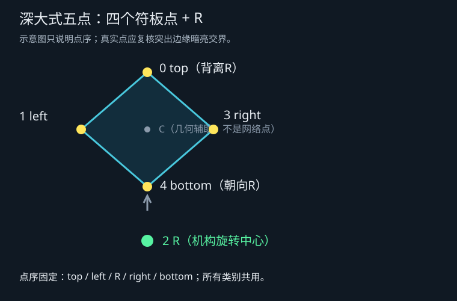

# 神符 YOLO 训练交接：与深大模型共用一套程序

更新：2026-10-29。训练在外部机器完成，本机只准备数据、代码接口和验证。

## 1. 本次要做什么

用当前自制符训练一份模型，在现有框架验证检测、位姿、跟踪、预测和火控。比赛时换为深大现成模型，使用同一套预处理、解码、点位含义和公共观测接口，只修改模型路径。

**新训练以深大的三类五点协议为准。旧 disk/r/ring 模型及“板心C＋四端点”协议已经退出 C++ 检测链路，不再为旧权重增加兼容分支。** 当前先完成小符训练和验证；保留大符类别、模式及算法入口，不把缺少样本的类别说成已经训练完成。

本文件是新训练的接口标准。旧数据目录中的 train_pose.py、export_pose.py 和旧训练参数用于历史 disk/r/ring 模型，不能直接用于本方案。

## 2. 唯一部署接口

以本项目已经核对的深大 model-0624.onnx 为基准：

| 项目 | 固定要求 |
|---|---|
| 输入 | FP32 `[1,3,480,640]`，即宽640、高480 |
| 图像处理 | BGR转RGB，等比例缩放、居中letterbox，填充值114，除以255，NCHW |
| 输出 | FP32 `[1,18,6300]`；只有一个输出，不在图内执行NMS |
| 类别 | 0=inactive，1=small_activated，2=big_activated |
| 五点 | 0=top、1=left、2=R、3=right、4=bottom |
| 坐标 | 网络输入画布上的像素坐标，不能交付0～1坐标或原图坐标 |
| 分数 | 已激活的类别分数和关键点分数，解码器不重复做sigmoid |
| 主交付 | ONNX及OpenVINO INT8 XML+BIN；同时保留FP32/FP16对照模型 |

18个通道依次为：

```text
inactive_score, small_activated_score, big_activated_score,
top_x, top_y, top_score,
left_x, left_y, left_score,
R_x, R_y, R_score,
right_x, right_y, right_score,
bottom_x, bottom_y, bottom_score
```

候选维度6300对应宽640、高480的8/16/32步长特征层。不得交付旧的22/24通道、端到端21通道、转置后的6300×18或640×640模型，然后要求工程识别另一套协议。INT8指网络内部量化，输入输出仍按上表保留FP32。

## 3. 类别与五点到底标在哪里

| ID | 名称 | 标注对象 |
|---|---|---|
| 0 | inactive | 尚未成功击打的完整或部分可见符板；不按红蓝再分类型 |
| 1 | small_activated | 小符被正确击打后的图案，按深大小符示例标点 |
| 2 | big_activated | 大符被正确击打后的图案，按深大大符示例标点 |

电控决定当前小符/大符模式，类别描述图像中的击打状态；不能用预测类别替代电控模式。不能根据圆环在图中大或小随意决定类别。新采集必须保存模式或可靠的采集说明；未确认的旧样本先复核，不混入已确认训练标签。

### 未激活符板：四个物理点＋机构R中心



| 点索引 | 定义 |
|---|---|
| 0 top | 背离R一侧的突出端部中点 |
| 1 left | 与深大示例一致的左侧突出端部中点 |
| 2 R | 机构旋转中心处R标的中心；不是符板自身圆心 |
| 3 right | 与深大示例一致的右侧突出端部中点 |
| 4 bottom | 朝向R一侧的突出端部中点 |

名称描述机构上的固定位置，随符板旋转，不能每帧按画面左上角重新排序。以R在下方、符板在上方的示意姿态确认左右后，再随机构旋转。深大符参考其边缘标注图；当前自制符按用户确认的最外端灯排中点标注，不能取包围框角、光晕外缘、整个突出矩形的中心或最亮的孤立像素。两者共用top/left/R/right/bottom的机构语义，不强行把不同结构的点挪成同一外形；PnP物理点尺寸需与各自实际端点匹配。旧端点仍须复核，不能直接当作已审核真值。


R不是单独一类。每个符板实例包含自己的R关键点，同画面多块符板可以共享同一个R位置。板心C不作为第六个网络点：检测代码用四个对应点的对径连线交点得到初始化值，再按配置进行局部图像精修。

### 已激活状态：不能套用待击板四点


小符已激活的四个点按上游示例落在圆环对应位置，R仍放在索引2。原ring只有一个圆心，不能复制圆心到四槽或按理想半径生成四点来冒充标注。 当前自制小符的红色内环同样标四个圆环点，外部蓝色装饰不改变类别。完整可辨轮廓上的正常灯珠间隙不等于遮挡，可以根据邻近可见弧线定位；真正遮挡或画外点仍置无效，不能用对称补全。

大符已激活的四点落在灯臂轮廓，参照 big.png，不一定是靶板的四个端点。当前代码保留该类解码及R观测，**不把灯臂中心当成半径0.7m处的靶心**；本阶段不验收大符已激活轮廓到靶心的专用几何。未激活板的PnP和后续既有预测框架继续共用。

### 缺失与遮挡

- 每个可可靠定位的点标 `v=2`；不可定位、出画或严重遮挡标 `0 0 0`，损失必须屏蔽对应坐标。
- 不用对称关系补点，不把光晕、反光或相邻目标的点拼进同一实例。
- R不见时只将索引2置无效，不强行删除仍有训练价值的符板。
- 缺臂符板保留真实可见点。推理至少三个有效点才保留候选；初始化要求R和完整四端点，初始化后可以接收可靠中心观测。
- 只有R而没有可标符板的图片先单独留作诊断；检查无遗漏符板后再决定其训练用途，不能把旧r类别直接改成新类别1。

## 4. 数据格式和现有数据如何迁移

可采用YOLO文本作为标注容器；每行20列：

```text
class cx cy w h top_x top_y top_v left_x left_y left_v R_x R_y R_v right_x right_y right_v bottom_x bottom_y bottom_v
```

框仅用于训练器的目标分配和标注查看，框住符板本体，不因远处R而扩成整根灯杆的大框。所有坐标按完整原图宽高归一化，R允许落在辅助框外。原图不预先拉伸为网络大小。

```yaml
names:
  0: inactive
  1: small_activated
  2: big_activated
kpt_shape: [5, 3]
flip_idx: [0, 3, 2, 1, 4]
```

这是标签容器，不代表未经修改的标准Pose训练器已经具备深大无框头。训练器的匹配、增强、裁剪及损失必须支持框外R和同R多实例。

当前原始数据在 rm/rune_pose，共825张；这些仍是旧标签，**尚未转换为可直接训练的新数据集**：

| 旧内容 | 数量 | 本次处理 |
|---|---:|---|
| disk待击板 | 650实例 | 旧四点重排为top/left/right/bottom，关联同图R后逐点复核 |
| r标 | 750实例 | 给对应符板提供索引2初值，不作为独立类别训练 |
| ring | 299实例 | 确认状态并补标四个真实位置；原圆心仅用于辅助查看 |
| 空标签负样本 | 75张 | 含白灯25张及装甲板、反光、环境等；复核没有漏标后保留 |

其中20个旧disk实例存在缺点，先保留可见信息再复核。299个ring目前都为红色，须补蓝色及不同尺度、亮度的对应状态。内外圆环外观分组不是电控模式真值；旧迁移草案里基于外观推定的类别仍需审核。

rm/rune_pose_v2_20261029保存825张的状态索引和查看页，不含新训练标签。rm/rune_pose_szu保存迁移候选及上游示例，也不是成品训练集。不要把任一目录直接命名为新训练交付包。

### 划分与补拍

按采集场次或完整视频分组划分train/val/test，同一段视频的相邻帧不得随机拆到不同集合。当前旧划分train700、val125；val缺少圆环、蓝色待击板及负样本，也没有独立test，必须重新按采集组规划并补独立素材。

先覆盖小符：红蓝待击板、小符已激活、多个符板共享R、R暂时缺失、远近尺度、斜视、残缺、拖影、过曝和白灯干扰。没有可靠大符素材就不伪造类别2；模型接口保留三类，但交付说明必须写清类别2尚未验收。

## 5. 交给训练AI的实现要求

1. 以深大五点模型为实现基准，优先复用其可获得的训练实现与权重，交付真实使用的网络定义、损失、匹配和导出代码。当前本地已核对的是模型及推理实现，不能声称已经取得原版完整训练器。
2. 训练目标是三类状态与五组坐标/有效性。若需要自行实现训练头，必须明确其与深大的差别，并实测导出结果与本工程一致；不能只靠改张量形状宣称复现训练精度。
3. 分类、关键点定位和有效性都要正确监督；v=0不得参与坐标损失。正样本位置围绕符板本体分配，不对含远处R的五点求均值作为符板中心。
4. GPU优先训练，CPU负责读图和增强；先检查训练机GPU、显存、CPU和内存，再确定batch和workers。显存不足先减batch，不把“CPU+GPU”当成两套同时训练同一模型的开关；无可用加速设备时保留显式CPU训练方式。
5. 正式训练200轮，关闭提前停止；保存每轮日志、best/last权重、随机种子、训练配置、依赖版本及真实曲线。不得在本机启动训练。
6. 首轮关闭翻转、mosaic和mixup，避免裁掉R或破坏点序。旋转、缩放和亮度增强必须同步变换全部点，不能无条件将框外R清零。以后启用镜像时按flip_idx交换left/right并先输出增强样例检查。
7. 保留真实颜色，不用随机色相增强将红蓝语义混淆。曝光、灯珠断续和光晕增强应接近实拍，不能以合成替代困难场景实拍。
8. 在独立测试集分别评估完整/残缺目标、红/蓝、各状态、不同尺度、白灯及反光；报告每点像素误差、漏检/误检、可初始化帧比例及连续丢失段。稳定性与人工真值误差分开报告。

## 6. 导出、量化与验收

先用FP32模型在留出的原图上确认标签和几何，再导出FP16及INT8。量化校准仅使用训练集的代表样本，覆盖曝光、颜色、尺度、状态及负样本；不能使用val/test来校准。记录校准样本清单、预处理、实际样本数量、工具版本及量化参数。

三个精度版本必须具有相同的输入输出名称、形状、点序和尺度。用同一批原图对比原始输出、解码坐标、关键点有效性和最终PnP结果，不只比较分类分数或模型文件大小。量化若明显损伤R或端点，交付误差分析及保留部分层精度的依据，不隐瞒为“都能加载”。

在i9-12900HK小主机CPU上，以单路单请求、OpenVINO低延迟模式实测。目标完整处理链持续约80FPS，即平均每帧约12.5ms；记录预处理、推理、后处理及跟踪火控耗时和P95，显示/录制是否开启要写清。训练机或其他电脑速度不能当作目标机验收结果。

交付至少包括：

```text
images/、labels/、data.yaml、按采集组划分及审核记录
训练与导出源码、依赖版本、训练配置和执行命令
best.pt、last.pt（或实际框架对应的可继续训练权重）
FP32 ONNX、FP16 XML+BIN、INT8 XML+BIN
每轮CSV、真实曲线PNG/SVG、分场景精度与时序结果
量化校准清单、模型SHA256、训练/导出/验收说明
```

接入本工程的最小检查：

```powershell
.\build\buff_detect_test.exe --self-test yolo
.\build\buff_pose_test.exe
.\build\buff_preview.exe tests/auto_buff/yolo_pose.yaml
```

修改yolo_pose.yaml的model可检查新权重；自检使用随工程保留的深大基准权重和参考帧。加载成功只是接口检查，通过数据精度、连续视频和目标机速度验证后才算新模型验收完成。

## 7. 当前代码与参考

- auto_buff/buff_detect/yolo：唯一三类五点解码，原图判色、中心距离去重、可选局部像素精修。
- auto_buff/buff_track/pose：沿用RMCS的R＋四端点PnP、重投影和整体几何检查。后续track/predict/shoot不区分权重来源。
- 类别0的四端点进入PnP；类别1只提供已击打圆环中心更新；类别2当前只提供R校正，不冒充靶板点。
- 电控模式、串口协议、相机时间戳及帧池不在此次模型接口修改范围。

深大基准来源：[SZURPVision/RuneDetectionModel](https://github.com/SZURPVision/RuneDetectionModel)。点序以实际部署代码中point_R=points[2]为准，不能照抄README里不同的点编号描述。已保存的上游图片及许可见rm/rune_pose_szu/docs；基准模型来源、SHA256及许可见auto_buff/buff_detect/yolo/model。

本地参考：开源/26_NNDeployment_Lib_and_Detection_Models-main的RunePostProcessor，以及开源/rmcs_auto_aim_v2-main的SingleRunePnpSolution和rune跟踪模型。
