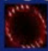
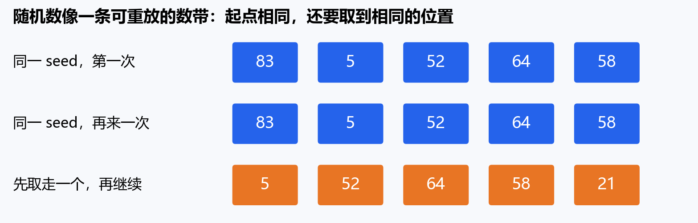
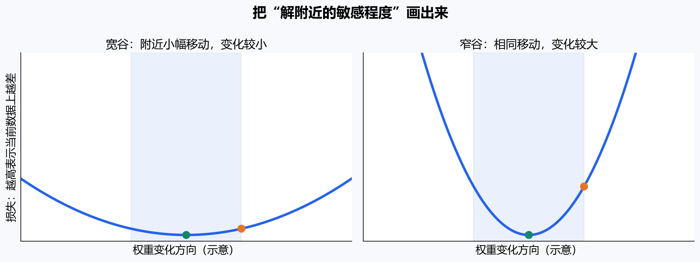
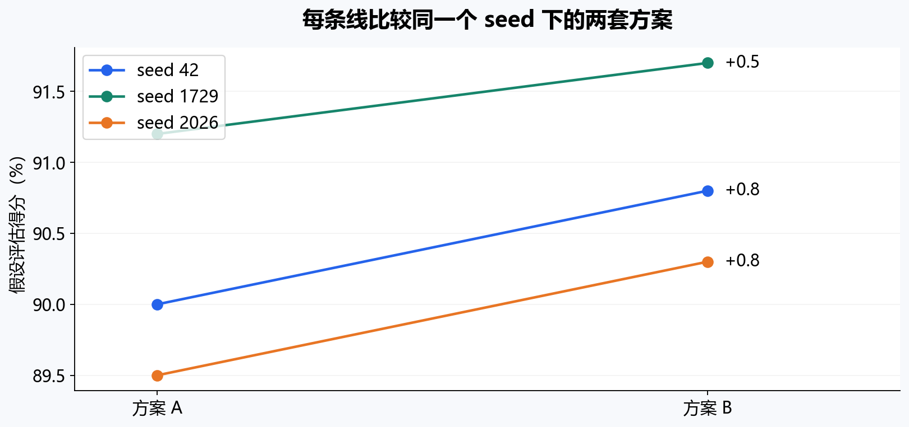
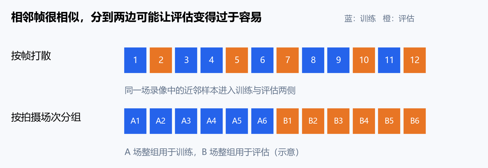
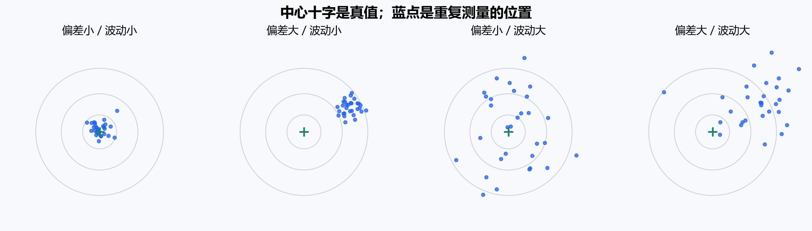
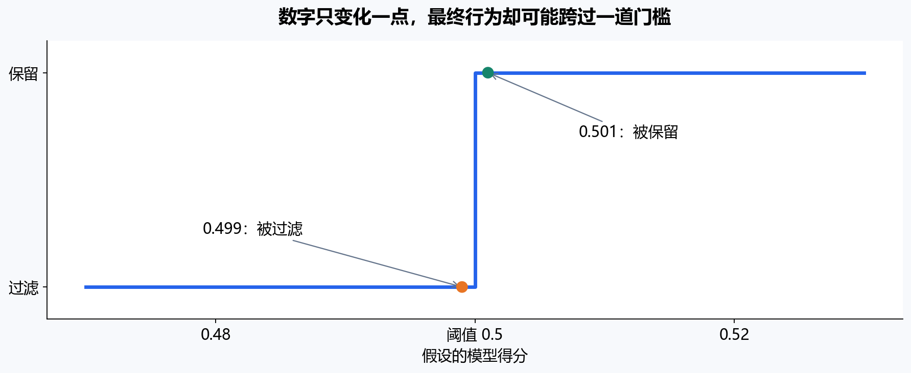

# AI 时代的训练工程：从一颗随机种子，认识更大的知识世界

> 为什么只改一个 seed，两次训练出来的模型就可能不同？从这个小问题出发，我们会遇到随机与秩序、计算机的精度、复杂系统、科学实验、认知偏差、光学测量等知识。理解这些联系，能让我们面对问题时多几个可用的视角。
>
> 本文以通识理解为主，不需要先会写训练代码。图片用来帮助观察，例子用来建立直觉，进一步阅读的资料放在相关段落旁。标注为“示意”的图和假设成绩均不代表本项目的实测结果。

## 一、先看看我们究竟希望模型学会什么

先看两张具体的图。它们是仓库中已有的符板示例，边框属于显示标记，不是灯珠结构。

| 能看到四臂结构的示例 | 以圆环结构为主的示例 |
| --- | --- |
|  |  |

**看图时先关注形状：**左图能看到环之外伸出的臂状结构；右图以环形亮点为主。再观察亮度：同一个目标内，灯珠亮核、周围光晕和暗背景的差别很明显。两图尺寸不同，不能据此比较真实目标的大小。

对人来说，这些线索似乎一眼就能看出。模型面对的却是一张由像素数值组成的表。它需要从大量样本中，形成把像素与类别、位置联系起来的判断规则。

这里已经出现了几个不同的问题：它是在看形状，还是在看背景？它知道类别，却能否找准端点？换一个角度、曝光或场地，它还认得出来吗？

所以，当有人说“这个 seed 训练出的模型比较好”，我们应先知道“好”指什么。

| 所说的“好” | 实际在观察什么 | 可能需要的知识 |
| --- | --- | --- |
| 同样条件下能再训练出来 | 结果可复现 | 随机数与计算过程 |
| 换一批样本仍能识别 | 能力能推广到新情况 | 泛化与统计学 |
| 遇到模糊、曝光变化仍可用 | 对干扰有承受能力 | 成像与鲁棒性 |
| 端点位置准确 | 测量接近真实位置 | 测量理论与几何 |
| 装到实际系统后运行可靠 | 整条处理过程有效 | 系统思维 |

这些能力彼此有关，也需要分别判断。我们就从 seed 这个最小的入口往外走。

## 二、seed：看起来随机的东西，也可能有可重放的秩序

### 1. 随机种子可以想成数带的起点

想象有一台机器，内部藏着一条很长的数带。你按一下按钮，它就给出下一个数。数带的排列看起来没有规律，但机器遵循固定规则。

训练中常用的伪随机数生成器，可以用这个比喻帮助理解。seed 用来初始化它的内部状态；生成器不断更新状态，产生后续数值。“数带”是帮助理解的示意，真实机器通常不会事先存下整条序列。

**看图：**前两行从相同状态开始，按相同过程取数，结果一致。第三行先取走一个数，后面就整体错了一位。这些数字来自同一个普通伪随机生成器的实际序列，只用于说明取数位置。

这能解释一个很容易困惑的现象：种子没变，但训练前多做了一次随机操作，后面的过程就可能变化。我们控制了起点，却改变了沿途的取数过程。

训练中有许多事情会用到随机数：初始权重怎样设置、先看哪张图片、图片怎样旋转、亮度怎样扰动等。它们还可能由不同的生成器负责，像几台各自转动的机器。

**这条知识有什么用？** 当结果无法复现时，可以想到“还有哪些内部状态或操作顺序没被控制”，而不只盯着 seed 那一个数字。

### 2. 从训练随机数，走向模拟实验与密码学

到这里，可以认识两个原本看起来离训练很远的领域。

**第一个是蒙特卡洛方法。** 它借助随机抽样，研究难以直接算清的问题。例如想知道系统在不同光照下失败的频率，可以抽取许多种光照条件，重复观察。电脑中看起来随机、同时又能重放的序列，恰好让这种模拟既有变化，也便于复核。

这个思路的关键在于：抽样覆盖了哪些情况、抽了多少次、结果波动多大。随机本身不会自动保证答案可靠。你也可以把它迁移到路径规划、传感器噪声分析、游戏模拟等问题上。

**第二个是密码学。** 训练实验希望能重放随机过程，安全系统则十分在意攻击者能否预测接下来的值。普通训练用伪随机生成器的设计目标，与密码学安全随机数的要求并不相同。Python 官方文档也明确提醒，普通 random 模块不适合安全用途。见 [Python 随机数说明](https://docs.python.org/3/library/random.html)。

这带来一种通用的选型意识：同样叫“随机”，适合科研复现的工具，未必适合生成密码。**先弄清任务要求，再判断工具的好坏。**

### 3. 为什么别人的“好种子”未必对你有用

seed 1729 并不携带“识别符板”的知识。它与数据、模型、学习过程共同作用，才产生一次具体训练结果。

换了数据，图片的读取顺序可能改变；换了网络结构，随机数的使用方式也可能改变。同一个数字所参与的过程已经不同，原来的成绩便无法直接搬过来。

加载相同预训练模型时，许多初始权重还可能完全相同，变化来自后续采样、增强或新建的任务部分。因此，“改 seed 就把整个网络换了一个起点”也只能用于部分情况。

理解了数带，我们可以继续问：假如连取数过程都一样，结果就一定相同吗？这会把我们带到计算机怎样表示数字的问题。

## 三、计算机怎样算数：有限精度与数值分析

### 1. 用一把刻度有限的尺子理解浮点数

真实世界中的长度可以比毫米更细，但只有毫米刻度的尺子无法把所有细节都写出来。计算机保存数字也有类似限制：它能使用的位数有限，许多数只能近似表示。

这类问题属于**数值分析**：数学方法进入有限精度的计算机后，会发生什么？怎样让计算结果尽量可靠？

先看一个简化例子。假设一台计算器每一步只保留三位有效数字，需要把一百万、负一百万和一相加。

| 运算顺序 | 在这台假想计算器里发生什么 | 结果 |
| --- | --- | --- |
| 先把一百万与负一百万相加，再加一 | 前两个数抵消，剩下一 | 1 |
| 先把负一百万与一相加，再加一百万 | 小小的一在舍入时丢失，前一步仍记为负一百万 | 0 |

数学里的精确加法，两种顺序应得到相同结果。有限精度计算中，每一步的舍入却会影响后面的答案。这就是理解“浮点加法不满足结合律”的一个入口；例中的三位精度是为了讲解而作的简化。

### 2. 为什么 GPU 与并行计算会出现在这条联系里

如果要加一百万个数，可以一个接一个加，也可以让许多人各算一组，最后汇总。后者就是并行计算中常见的归约思路。

分组方式、汇总顺序或所选算法变化，可能让舍入结果不同。CPU 也会并行，GPU 也可以采用确定的计算方式，因此不能简单理解为“CPU 一定，GPU 随机”。

更需要区分的是：**存在舍入误差，与每次运行都会变化，是两回事。** 同样输入按同样方式计算，可以重复得到同样的近似值。想复现结果，就要同时关注随机过程和实际计算过程。关于训练复现的环境限制，可进一步阅读 [PyTorch 可复现说明](https://docs.pytorch.org/docs/2.9/notes/randomness.html)。

### 3. 精度、范围、稳定性，分别是什么意思

| 概念 | 可以怎样想象 | 它帮助回答什么问题 |
| --- | --- | --- |
| 精度 | 尺子的刻度有多细 | 很接近的两个数能否区分 |
| 数值范围 | 尺子能量多长 | 太大或太小的数能否表示 |
| 数值稳定性 | 计算过程会怎样处理小误差 | 舍入会不会被过度放大 |
| 确定性 | 同样过程能否重做出同样结果 | 结果是否可重复 |

这也能帮助理解常见的 FP32、FP16、BF16。

FP32 通常能保留更多有效数字；FP16 使用的位数更少，计算和存储成本可能更低，但表示范围也较小；BF16 在有限位数中给指数留下更多空间，范围与 FP32 接近，细节精度则较低。

用摄影作类比：一张照片可以容纳很宽的明暗范围，却未必保留很细的纹理。“装得下多大的变化”和“分得清多细的差异”需要分别考虑。这个比喻用于区分两个维度，并不表示浮点格式与相机结构一一对应。

**什么时候有用？** 遇到计算结果异常、不同设备有细微差异、降低精度后性能变化时，可以先分清问题属于哪个维度。它也同样适用于几何计算、金融模拟和科学计算。

## 四、一点差异怎样影响最后的结果：复杂系统与优化地形

### 1. 下一步，取决于你现在站在哪里

想象在山里行走：此刻站的位置，会影响下一步看到的坡度；下一步走向不同，之后遇到的路也可能不同。

训练有类似的反馈过程：当前权重决定当前预测，预测误差影响更新，更新后的权重又影响下一轮。早先的差异可能改变后续路线。

这让我们接触到**动力系统**的视角：研究系统状态怎样随时间演化。天气、摆动、生态种群、交通拥堵，都可以提出类似问题——当前状态怎样影响下一刻？一个小扰动会被压下去，还是逐渐放大？

“蝴蝶效应”是熟悉的比喻，但它有边界。不能据此断言所有神经网络的差异必然指数增长，也不能把天气系统的具体结论直接搬到训练上。这个联系首先教我们关注反馈与长期演化。

### 2. 把训练画成地形，能看懂什么

为了讨论某种预测有多差，训练会使用损失。可以先把损失想成“当前答卷的扣分”，越低表示在这个标准下表现越好。

如果横向表示权重的变化方向，纵向表示损失，就能画出一张帮助理解的地形图。

**看图：**两边绿色点都在谷底。向右移动同样的距离，左边橙色点只升高一点，右边却升高很多。它说明两种位置附近的敏感程度不同。曲线是二维教学示意，并非真实模型的损失测量。

“平坦极小”“尖锐极小”讨论的正是这类局部性质。真实网络的参数维度很高，而且表示权重的方式也会影响观察到的尖锐程度。因此，宽谷与泛化之间的关系需要具体研究，不能把这张示意图理解成“谷底宽就一定适应赛场”。参见 [Sharp Minima Can Generalize For Deep Nets](https://arxiv.org/abs/1703.04933)。

### 3. SAM：从“自己答得好”，走向“附近也别太差”

SAM 是一种研究优化过程的方法。它会考虑：权重附近受到小扰动时，损失会不会明显变坏？随后调整训练方向，希望找到附近表现也较好的位置。见 [SAM 原论文](https://arxiv.org/abs/2010.01412)。

可以把它类比为调试机械装置：理想尺寸下能转动是一回事，零件尺寸稍有偏差时还能否工作，又是另一种要求。

这个联系引出了**容差与鲁棒设计**：设计时同时考虑扰动下的表现。机械、控制、通信等领域都会关心这一问题。不过，权重扰动、零件误差和图像曝光变化是不同对象，它们需要各自的分析，不能凭类比认定方法可以直接互换。

**带回来的思路：**评价一个答案时，除了看它在某一点多漂亮，还可以问，它在附近变化时是否脆弱。

### 4. 多个好答案之间，还可能有什么联系

再往外走，可以认识三个研究方向：

| 名称 | 先用一句话认识它 | 它打开了什么问题 |
| --- | --- | --- |
| 彩票假说 | 某些稀疏子网络配合原有初始化，能有效重新训练 | 网络结构与初始化怎样共同影响学习 |
| 模式连通性 | 某些不同训练解之间，可以找到低损失的连接路径 | 好答案之间是否存在可利用的结构 |
| 深度集成 | 结合多个模型的预测，并研究它们的不确定性 | 多个判断怎样互补，分歧能透露什么 |

进一步阅读：[彩票假说](https://arxiv.org/abs/1803.03635)、[模式连通性](https://arxiv.org/abs/1802.10026)、[深度集成](https://arxiv.org/abs/1612.01474)。这些研究有各自的条件；不能直接推出两份权重随便平均就有效，也不能认为多个模型一致就一定正确。

初次接触时，先知道这些方向研究什么。今后遇到网络压缩、模型融合或难例筛选，就多了几个可以寻找答案的地方。

## 五、成绩提高了，真是方法有效吗：科学实验与选择偏差

### 1. 从“跑赢一次”走向公平比较

假设你比较两种学习方法，却让一组学生拿到简单试卷，另一组拿到难试卷。最后的分数差，很难说明教学方法的作用。

训练方案比较也一样。若数据、初始条件、训练预算同时变化，就难判断究竟是哪一项带来了提升。

科学实验里的一个基本思路是**控制变量**：尽量让比较双方处于可比条件。再进一步，可以做配对比较，让相同的随机种子分别参与两套方案。

**看图：**每条线连接同一个 seed 下的 A、B 成绩。三条线都向上，说明在这个小例子里，B 的改善没有只出现在某一个 seed 上。这些是教学用假设分数，不是实际训练成绩。

它仍不足以证明 B 在所有情况下更好。还要看试验次数、波动、数据代表性，以及提升是否集中在某个场景。

从这里还可以认识模拟实验中的**共同随机数**思路：让比较双方承受相近扰动，帮助减少干扰。不过训练中只设置相同 seed，未必能让每个样本经历完全相同的随机变化。

**能带回什么？** 以后看到一次高分，可以继续问：换几次初始条件，结论还在吗？两边是在同样条件下比较的吗？

### 2. 为什么越挑越好的成绩，可能越乐观

想象让很多人各投十次篮，再挑命中最多的人。被挑中的那个人可能很有实力，也可能恰好在这十次里手感特别好。下一轮表现，未必保持刚才的高度。

挑模型也会遇到这种问题：许多候选真实能力接近，评估成绩却各有波动。挑最高分时，也可能挑中了最有利的一次偶然波动。

这属于**选择偏差**。它的一个常见表现被称为赢家诅咒：胜出的观察值可能高估长期能力。这不代表筛选没有价值，而是提醒我们，选出来的结果还需要新的独立证据。

更隐蔽的情况是，模型权重没再更新，人却一直根据同一份评估结果换 seed、改阈值、调参数。方案仍在逐渐适应那份数据。这是**自适应数据分析**关心的问题。见 [保留集反复使用的研究](https://arxiv.org/abs/1506.02629)。

所以，反复拿来选模型的数据承担的是选型作用。想了解对陌生情况的表现，还需要留出没有参与选择的材料。

### 3. 录像有一万帧，就有一万个独立样本吗

想象考试时，练习册里连续一百道题只是换了几个数字。会做这一百题，并不等于掌握了一百种不同知识。

一段录像的相邻帧也很相似：同一场地、同一目标、接近的姿态和曝光。若把这些帧随机分到训练与评估两边，模型就可能在评估中见到非常熟悉的情况。

**看图：**上排来自同一场录像的近邻帧被分到两边；下排把 A 场与 B 场整体分开。下排更适合检查对另一场拍摄的适应情况，但 B 场是否足够代表未来工况，仍要另外判断。

这里引出了**样本相关性**：数量多，不等于信息独立。连续一百帧的同一次失败，与一百个独立场景中的失败，证据分量不同。

这个视角可以迁移到医学连续测量、用户行为数据和金融时间序列。处理分组及时间相关数据，可进一步阅读 [交叉验证说明](https://scikit-learn.org/stable/modules/cross_validation.html)。

## 六、它究竟学会了什么：相关性、捷径学习与知识迁移

### 1. 在熟悉题目上答对，可能有不同原因

回到开头的符板图片。假设训练数据里的四臂图案大多在明亮实验室拍摄，圆环图案大多在昏暗场地拍摄。模型可能发现：看整体亮度，就已经能答对很多题。

亮度与类别在这批数据里相关，却未必是类别成立的原因。到了新场地，这种联系可能消失。

这叫**捷径学习**：利用了一条在已有材料上有效、到了真正任务中却不可靠的规律。它与人只记住题目版式、答案位置有相似之处。相关讨论见 [Shortcut Learning](https://arxiv.org/abs/2004.07780)。

### 2. 从这里走向“相关不等于因果”

看到两个现象同时出现，可以提出猜想，却还需要更多证据判断原因。

例如，“换 seed 后，角点稳定了”至少可能有几种解释：这次模型确实学得更好；评估画面更容易；曝光改变了；像素精修或跟踪方式变了。只观察前后变化，尚未把这些可能性区分开。

因果思考帮助我们继续问：如果只改变这一项，其他条件保持相近，会发生什么？若把背景换掉、把亮度改变，结论还能保持吗？

这些对照不能自动揭示模型内部全部机制，但能帮助排除一些解释。它们让“我猜模型看的是背景”变成可以调查的问题。

### 3. 分布偏移：同一项任务，材料已经变了

“分布”可以先理解为一批数据中各种情况出现的方式和比例。开发时近距离、正视、清晰图像很多；使用时远距离、侧视、模糊图像很多，模型面对的条件就变了。这类变化称为分布偏移。

| 可观察的变化 | 图像中可能发生什么 | 可以借用的视角 |
| --- | --- | --- |
| 目标更远 | 结构只占很少像素 | 分辨率与测量精度 |
| 曝光变化 | 亮核、光晕与背景关系改变 | 成像与动态范围 |
| 运动更快 | 边缘在曝光期间移动 | 时间尺度与运动模糊 |
| 遮挡变多 | 区分结构可能不可见 | 信息是否足够 |
| 背景改变 | 原来有效的背景线索消失 | 捷径与相关性 |

遇到这些情况，可以按工况分开看表现。一个总体平均值，可能把少数关键场景的失败掩盖掉。mAP 等指标仍有价值，但需要知道它是在什么材料上测出的，又覆盖了哪些能力。

**这条联系带来的判断：**高分要和评估条件一起阅读。就像成绩单需要看考试内容，模型分数也需要看它面对的题目。

## 七、图像有没有给出答案：光学、信息与测量理论

### 1. 模型没学会，与画面没有提供，要分别考虑

面对陌生角度，补充这类样本可能有帮助。但若端点被完全挡住，图像中就缺少直接定位它的依据。系统或许能利用历史和结构猜测，猜测依赖的假设仍需要说明。

当开头左图的四臂被遮住，只剩可见圆环时，视觉证据已经发生变化。此时观察到类别短暂变化，不能只凭这一点认定算法出了错，还要查看遮挡程度与任务的标注要求。

从这里可以走近**信息论的提问方式**：观测究竟包含了多少与问题有关的信息？不同真实情况，会不会产生难以区分的观测？本文不推导信息量公式，但这个问题本身就能帮助定位能力边界。

### 2. 从灯珠走到像素，中间经历了什么

可以把成像过程粗略想成一串转换：灯珠发光，光经过镜头到达感光元件，曝光期间积累信号，再形成离散像素。

这意味着“图上最亮的位置”“可见光晕的边缘”“物体的物理端点”可能并不重合。运动还会让同一特征在一次曝光期间经过多个位置，表现出拖影。

所以，同一块板在不同拍摄条件下，像素精修可能测到不同的亮度边界。把问题全部归到训练 seed，容易遗漏成像这一层。

这与工业视觉选光源的思路相通：先让需要测量的特征稳定地呈现在图像中，再讨论算法怎样提取。具体光源、镜头、曝光的选择，需要结合对象、材质与运动情况，不能只凭“越亮越好”决定。

### 3. 用靶图分清“准确”与“稳定”

**看图：**绿色十字是真实位置，蓝点代表同一对象的重复测量。第二组蓝点很集中，却集中在错误的位置；第三组平均接近中心，单次结果却分散。

这就是测量中的两种问题：**偏差**表现为总体偏向某个方向，**波动**表现为重复结果彼此分散。图中点是人为生成的教学示意。

它能直接帮助理解角点精修：

| 现象 | 可以怎样理解 | 进一步需要什么 |
| --- | --- | --- |
| 点一直在端点附近跳 | 波动较大 | 查看成像噪声、模型与提取过程 |
| 点很稳，但始终偏向光晕外侧 | 存在系统偏差 | 用可靠参考核对测量定义 |
| 平滑后更稳，却跟不上目标 | 可能有响应延迟 | 同时观察时间上的行为 |

重复测量有助于观察波动；判断准确性还需要真实参考。一个更平滑的结果，可能同时保留原来的偏差。

### 4. 为什么一像素在远处更重要

想象用照片估计一个已知宽度的物体有多远。它在图上越小，通常表示越远。在正视、相机条件固定等简化前提下，图像宽度与距离近似成反比。

如果目标宽度是 300 像素，1 像素只占它的约 0.33%；如果只剩 30 像素，1 像素就占约 3.3%。同样的宽度误差，对距离估计的相对影响便可能明显不同。

这属于**误差传播**：前一步的小偏差经过后续计算，影响最后的结果。实际位姿计算还会受姿态、标定、几何分布等因素影响，这个例子只用于建立尺度直觉。

所以“近处稳定、远处抖”会把我们引向镜头与分辨率、目标尺寸、几何敏感性等领域。换 seed 只是可能调查的方向之一。

## 八、从分数到行为：阈值、压缩与系统思维

### 1. 微小变化为什么会突然变得明显

假设系统规定模型得分达到 0.5 才保留目标。0.501 与 0.499 只差 0.002，处理结果却分处门槛两边。

**看图：**横轴是得分，纵轴是过滤或保留。蓝线在阈值处跳变，小范围数值变化就可能变成明显行为变化。图中的门限是假设规则，不表示得分就是经过校准的正确概率。

这种现象也能帮助理解温控开关、报警系统、考试分数线：连续变化的量经过一道离散判断，行为可能突然切换。它提醒我们特别关注临界区域，而不只看平均变化有多小。

### 2. 模型压缩为什么与这件事有关

为了减少存储和计算成本，部署时可能让部分数值使用更少的表示位数。这类量化可以粗略类比为把精细刻度换成较粗刻度。

很多变化对最后判断没有影响，少数恰好位于门槛附近的样本却可能改变处理结果。因此，“平均数值差别很小”不一定能概括全部使用体验。OpenVINO 的[训练后量化说明](https://docs.openvino.ai/2024/openvino-workflow/model-optimization-guide/quantizing-models-post-training.html)介绍了代表性校准数据等相关要求。

这里也要区分两种情况：换场地改变了输入材料，属于环境与数据的问题；同一图片经过不同计算过程后输出改变，则需要调查输入处理、数值表示和算法实现。

### 3. 局部更好，为什么整套系统未必更好

一套视觉系统往往经历图像采集、识别、位置测量、几何求解、跟踪和决策。每一步都在处理上一步给出的材料。

更大的模型可能识别更准确，同时花更长时间；更强的平滑可能减少抖动，同时增加延迟；更严格的筛选可能减少误检，同时拒绝更多可用观测。这些取舍要结合最终任务衡量。

这就是**系统思维**的一种用法：把局部指标放回整体目标，观察代价怎样传递。它也适用于生产流程、网络服务和机械设计。

面对“换 seed 后上场更好了”，现在可以进一步问：改善发生在哪一层？付出了什么代价？在新场景里是否保持？这些问题能让经验更容易被复核和迁移。

## 九、带着哪些新视角，回到最初的问题

读到这里，“为什么两次训练不同”已经连接到了许多领域。

| 新认识的领域 | 给我们增加的一种提问方式 | 适合什么时候想到它 |
| --- | --- | --- |
| 随机过程与状态 | 起点相同，过程是否相同 | 结果难以复现 |
| 蒙特卡洛方法 | 能否用多次抽样观察变化范围 | 条件组合很多，难以一次算清 |
| 数值分析 | 表示精度与计算方式怎样影响结果 | 设备或精度变化后行为不同 |
| 动力系统与鲁棒设计 | 扰动会怎样沿后续过程传播 | 微小变化引发长期差异 |
| 科学实验与统计学 | 这次提升能否排除偶然因素 | 比较训练或算法方案 |
| 选择偏差 | 是否挑中了偶然有利的结果 | 候选很多、反复选型 |
| 捷径学习与因果思考 | 它依赖的线索在新条件下还成立吗 | 熟悉数据高分，换场景失效 |
| 信息与测量 | 图像提供了什么，测到的又是什么 | 遮挡、过曝、位置偏差 |
| 系统思维 | 局部收益怎样影响整体任务 | 单项指标变好，使用体验未改善 |

这些领域不用一次学完。可以先选一条最贴近当前困惑的联系，理解它的基本问题、观察方法和适用范围。

使用 AI 辅助学习时，也可以这样追问：“从这个现象出发，介绍两个我可能没接触过的领域。先给具体例子或图片，解释它们为什么相关，再说明能怎样帮助判断问题。”随后核对依据，必要时用简单观察检验。

这会让一次求助留下更多东西：下次遇到陌生问题时，你知道还可以往哪些方向寻找答案。

## 一个可以留作记忆点的小彩蛋

1729 可以写成两种正整数立方和：1³＋12³，以及 9³＋10³。

它把一个训练参数顺手带到了数论。不过，这个有趣性质并不能解释训练质量。数字的故事帮助记忆，模型能力仍要放回数据、学习过程和使用条件中判断。

---

**图片说明：**两张符板图复用本仓库已有示例，保留原图。其余六张为本次绘制的教学图，其中随机数图展示一个生成器的取数序列；地形、评分、分组、散点和阈值图用于解释机制。所有图都不作为真实模型精度、泛化能力或比赛效果的证明。
