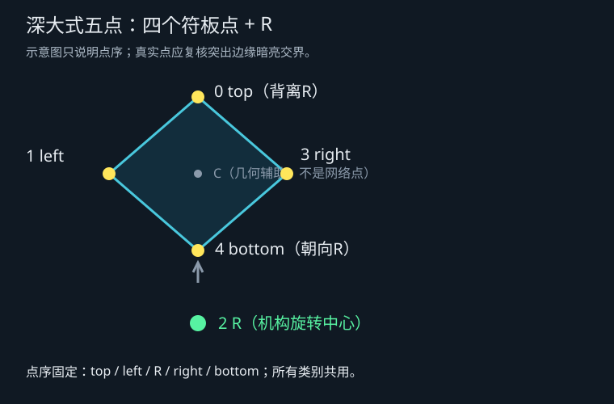
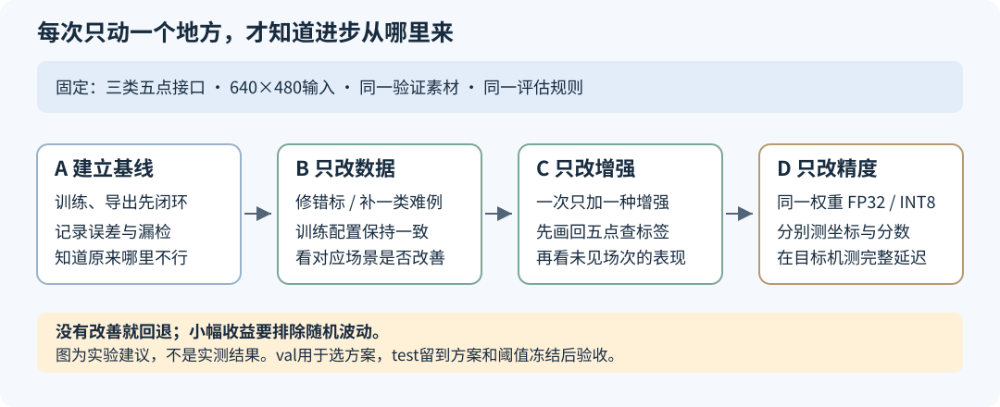
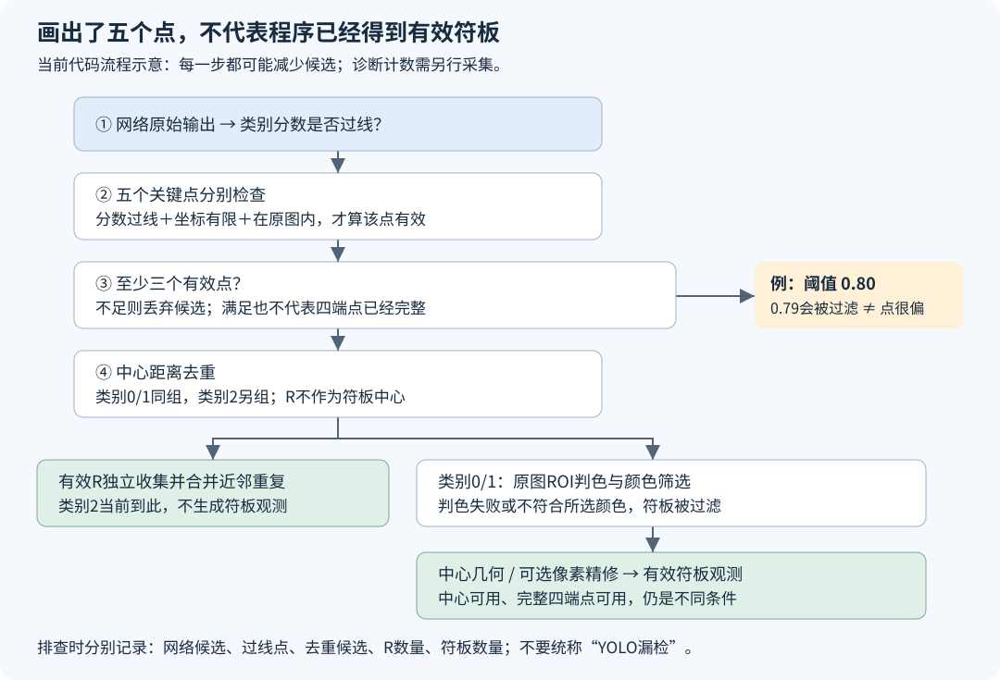

# 神符YOLO入门手册：标数据、训练、排错与部署

部署补充（2026-11-22）：CMake 的 `YOLO_RUNTIME` 选择推理 SDK，默认 `OPENVINO`，Jetson 可选 `TENSORRT`。只编译、链接选中的 SDK；`auto_buff.detect.yolo.device` 再选择设备。OpenVINO 支持 CPU 单槽同步、GPU 双槽异步，`threads` 仅 CPU 读取；TensorRT 使用 GPU 双槽异步，不读取 CPU 线程数。设备不可用时直接报错，不自动回退。

实机通过 `BuffDetector::create(config)` 构造检测器。所有后端使用 `submit()` / `collect()`；GPU 固定两个请求，满槽返回 false，结果按提交顺序交付，推理请求由 YOLO 内部管理。工作线程负责配对帧与有效期检查。

`observation/` 负责把模型输出转换为公共检测观测，`pixels/` 提供原图判色、轮廓提取和像素精修。

`yolo.cpp` 负责解码、观测转换和精修；`inference.cpp` 共用预处理、帧上下文和 FIFO，`openvino.cpp` / `tensorrt.cpp` 各自管理厂商资源。对外检测接口不变，厂商头文件不进入 `yolo.hpp` 或 `inference.hpp`。

### Orin NX：构建与运行

需要 TensorRT 10 及以上的开发包、CUDA Toolkit 和工程原有依赖；当前按 TensorRT 10.3 API 接入。engine 在目标 Jetson 上提前生成，启动程序只加载，不在线转换；更换硬件或 TensorRT 后重新生成。

```bash
mkdir -p output/engines
/usr/src/tensorrt/bin/trtexec \
  --onnx=auto_buff/buff_detect/yolo/model/rune_szu.onnx \
  --saveEngine=output/engines/rune_szu_fp16.engine \
  --fp16 --inputIOFormats=fp32:chw --outputIOFormats=fp32:chw --skipInference

cmake -S . -B build-trt -DCMAKE_BUILD_TYPE=Release \
  -DYOLO_RUNTIME=TENSORRT -DBUILD_TESTING=ON
cmake --build build-trt --target mas_vision tensorrt_execution_test -j4
./build-trt/tensorrt_execution_test output/engines/rune_szu_fp16.engine
```

在原 YAML 的 `auto_buff.detect` 下选 `backend: yolo`，仅将 `yolo.model` 改为 `../output/engines/rune_szu_fp16.engine`，`yolo.device` 设为 `GPU`。共有颜色和 debug 配置照旧。运行 `./build-trt/mas_vision`。

engine 内部允许 FP16，外部接口固定 FP32/LINEAR，输入 `[1,3,480,640]`、输出 `[1,18,6300]`；不接受动态尺寸或带额外输出的模型。测试检查 FIFO、满槽拒收、槽位复用和带在途请求销毁，性能及识别精度需另行上机验收。CTest 未提供 engine 时跳过此硬件测试；几何与像素精修检查仍运行，固定使用 OpenVINO/CPU 的检查不运行。

Intel 机器继续使用默认配置，或显式传 `-DYOLO_RUNTIME=OPENVINO`；模型仍使用 XML/ONNX。TensorRT 路径不加载 OpenVINO。

更新：2026-10-29。面向刚接触模型训练的队员。目标是让自制符训练模型与深大模型共用一套C++程序，先验证小符。训练在外部机器完成，部署目标为i9-12900HK小主机、OpenVINO CPU，完整链争取持续80FPS；性能必须实测。

2026-10-30补充：结合AT_NN_Detector的工程经验，增加实验对照、分数与点位误差排查、量化退化定位的图文说明；本工程三类五点接口不变。

[根目录训练交接标准](../../../TRAINING_YOLO_POSE.md)规定最终接口，本文负责解释“为什么、怎么一步一步做”。原825张数据尚是旧协议，不是新训练成品。本文不会把不存在的深大完整训练脚本写成一条已经可执行的命令。

## 1. 本手册借鉴谁，怎样学习

优先参考作者课程与官方资料，下面是简短方法归纳；后面的具体步骤为本工程的整理，不是原文翻译或整篇转载。

| 参考 | 借鉴的教法 | 本工程对应动作 |
|---|---|---|
| [Sergey Karayev：FSDL Data Management](https://fullstackdeeplearning.com/course/2022/lecture-4-data-management/) | 先理解数据、统一标签、管理版本 | 先看实拍、定点位、按采集组划分，保存数据清单 |
| [Charles Frye：FSDL Troubleshooting & Testing](https://fullstackdeeplearning.com/course/2022/lecture-3-troubleshooting-and-testing/) | 用小样本记忆测试尽早发现训练问题 | 先让少量已审核样本学得会，再正式训练 |
| [Ultralytics标注指南](https://docs.ultralytics.com/guides/data-collection-and-annotation/) | 保证标注规则一致 | 用同一套五点模板，放大复核，区分漏标与负样本 |
| [Ultralytics Pose格式](https://docs.ultralytics.com/datasets/pose/) | 从实例、归一化坐标和有效性理解标签 | 每块符板一行，固定点序，缺失点正确屏蔽 |
| [OpenVINO性能配置](https://docs.openvino.ai/2026/openvino-workflow/running-inference/optimize-inference/high-level-performance-hints.html) | 区分延迟与吞吐 | 同时记录FPS和曝光到输出的结果年龄 |
| [河北科技大学AT_NN_Detector](https://github.com/PraySky1337/AT_NN_Detector#为什么我是这么做的) | 重视数据质量，在实际设备上检查网络结构与量化的收益 | 固定接口做单项对照，分别检查坐标、分数和完整链路耗时 |

AT项目检测的是装甲板，本工程检测的是神符。下面借鉴的是实验方法，不是把装甲板权重、四角点或AX650实现直接搬来。相关解释是结合本工程重新整理，不代表上游已经在本工程硬件上验证。

阅读顺序：先弄懂第2节→照第3～6节完成一个小批次→检查第7节训练接口→再读质量与性能部分。不要一开始就同时改网络、标签、增强和量化。

## 2. 先认清我们到底训练什么

普通目标检测回答“是什么、框在哪”；Pose还回答“指定的物理点在哪”。本工程不训练人体关节，而是四个符板点和远处的机构R中心。

### 2.1 三类描述击打状态，不描述颜色

| ID | 名称 | 含义 |
|---|---|---|
| 0 | inactive | 未激活/待击打符板 |
| 1 | small_activated | 小符正确击打后的状态 |
| 2 | big_activated | 大符正确击打后的状态 |

红蓝在原图ROI中判定，不拆成六类；R不是独立类别。大小符模式由电控提供，不能让类别预测替代模式。状态确认依据真实采集记录和结构，不凭圆的像素大小猜类别。暂时没有可靠大符样本时，保留类别2的接口并注明未验收，不伪造标签凑齐。

### 2.2 五点顺序固定，旋转后也不改名



| 索引 | 名称 | 未激活板上的位置 |
|---|---|---|
| 0 | top | 背离R的突出端部中点 |
| 1 | left | 按上图参考姿态定义的左端部中点 |
| 2 | R | 机构R标中心，不是符板中心 |
| 3 | right | 右端部中点 |
| 4 | bottom | 朝向R的突出端部中点 |

先在“R在下、符板在上”的参考姿态确定左右，再随机构旋转。不能转一圈后重新按画面左上排序。红符点可用青色显示、蓝符点可用黄色/橙色显示，避免点与灯珠同色。


四点是物理边缘端部的中点，不是包围框角，也不是外部光晕。当前自制灯珠结构可参考此前确认的最外端灯排中点，但必须与深大边缘定义及PnP物理尺寸一起复核，不能把两种不同机械位置混为同一真值。

一块板对应一个五点实例；同图两块板各标一组，组内R可落在同一个位置。符板圆心C由几何计算，不是第六个模型点。

### 2.3 激活后点位可能不同


小符已激活按对应圆环位置标四点，R仍在索引2。大符已激活的点落在灯臂轮廓，不是待击靶板四端点。当前C++保留类别2独立灯臂五点与实测轮廓；pose 用同帧完整待击板求符面，采用深大灯臂物理模型和距离变换逐杆匹配转角，再投影已激活板心。失败不输出推导中心，也不覆盖原始网络点。该分支仍待真实大符精度验收，见根目录 YOLO.md。

当前自制小符激活后，蓝色外部装饰仍可能亮着，红色内环才是本批数据的四点标注对象；不能因内环较小就改标大符。圆环四点按R相对方向定位，不要求恰好落在单颗灯珠上：完整可辨的圆环中，灯珠之间的正常间隙不算遮挡，可沿可见弧线确定该处轮廓位置；真正被遮挡或裁出画面的点仍置为无效。未激活板继续按自制符最外端灯排中点标注。两种机构共用接口，并不保证这些端点的实际物理尺寸相同；PnP前须核对各自尺寸，不能只换模型就声称空间位姿准确。

## 3. 第一步：采集真正有用的数据

先录不同工况，再抽有差异的帧。连续1000张几乎相同的图片，不等于覆盖了1000种场景。

| 维度 | 至少考虑的变化 |
|---|---|
| 距离/尺度 | 近、中、远；小目标在640×480画布中是否还看得清 |
| 颜色/状态 | 红蓝待击板、小符已激活、共享R；大符以后单独补齐 |
| 曝光 | 正常、偏暗、过曝、灯珠断续、光晕 |
| 运动 | 不同转角、方向、速度、拖影和云台运动 |
| 遮挡 | 缺一端、画边截断、R暂时不可见 |
| 干扰 | 白灯、装甲板、反光、其他圆形灯、复杂背景 |

为每段视频记录`场次/相机镜头/分辨率/曝光增益/大小符模式/距离范围`。抽帧时看完整状态变化，不只选择模型已经会识别的好看画面。

现有825张来源在[rm/rune_pose](../../../rm/rune_pose)；[状态查看目录](../../../rm/rune_pose_v2_20261029)只是旧数据的索引。旧数据650个disk、750个独立R、299个ring、75张空标签负样本，不能直接把类别ID沿用为新三类。尤其旧类别1=r，新类别1=小符已激活，含义完全不同。

### 按采集组分割，防止数据泄漏

先按完整视频/场次分组，再分train、val、test。可以从约70%/15%/15%的组划分起步，这是示例比例，覆盖真实工况比凑比例重要。增强和近重复图片必须跟随原图所属集合，不能跨集合。

- train供模型学习；校准INT8也从其代表样本取。
- val用于选参数、阈值和检查模型；反复查看val不是独立验收。
- test留作最终独立评估，不参与调参、回流训练或量化校准。

现有旧val缺少蓝色待击板、圆环和负样本，也无独立test。不要沿用它来证明新模型“场上都能识别”。

## 4. 第二步：在工具里逐张标注

可用CVAT的Skeleton功能建立五点模板，并导出COCO Keypoints再转换。以下是通用操作流程，具体按钮名称随版本变化；参照[CVAT官方Skeleton教程](https://docs.cvat.ai/docs/annotation/manual-annotation/shapes/skeletons/)。也可使用已有工具，只要能可靠保存顺序、状态和逐点有效性。

1. 建立inactive、small_activated、big_activated三个标签，每个绑定完全相同的五点名称和顺序。
2. 导入一个采集组，先确认图像方向和实际像素尺寸。
3. 对每块符板建立一个实例，选择正确状态；标四个板上位置及其机构R。
4. 放大到能分辨灯珠/边缘的位置，按统一规则点中点；缩回全图确认没有关联到别的R。
5. 缺失点按工具的不可用状态处理，导出后核对为v=0；不要仅隐藏显示却仍保留有效标签。
6. 同图其余可标目标也要标全，不能只标最显眼的一块。
7. 导出后按名称重排为本工程五点索引，再生成训练TXT和可视化复核页。
8. 抽取不同标注员的重叠样本互相审核；有分歧先修规则，再返工整批相同问题。

**骨架的自动外接框可能包含远处R。** 本工程的辅助训练框只覆盖符板本体，转换时要独立保存/核对，不能盲用包含R的大框。不要为了让R落进框内而移动R。CVAT导出的COCO类别ID也不保证就是0/1/2，需要显式映射。

### 看不清时怎么处理

本项目采用：可靠可见点v=2；不可定位点`0 0 0`。通用COCO还有v=1（标有位置但被遮挡），但本项目不靠猜测补造遮挡位置；使用v=1前须另定统一审核规则和损失行为。

| 情况 | 正确处理 |
|---|---|
| 外圈光晕比灯珠亮 | 按真实结构定位，无法确定则该点无效 |
| 下方板画外缺一端 | 保留其余可见点，缺点v=0 |
| R不在画内 | 只将R点置无效，不删除整块仍有价值的板 |
| 只有R没有符板 | 单独复核和保留诊断用途，不标成small_activated |
| 有符板但标不清 | 保留待复核，不当空标签负样本混入 |
| 白灯干扰且确实无目标 | 图片配同名空TXT，不创建background类别 |

## 5. 第三步：理解标签文件，避免导出就标错

本工程可用YOLO文本作为标注容器。一图一TXT，一实例一行；五个点都带有效性时，每行20列：

```text
class cx cy w h top_x top_y top_v left_x left_y left_v R_x R_y R_v right_x right_y right_v bottom_x bottom_y bottom_v
```

前4个数是辅助框中心和宽高，不是四个角；点坐标和框坐标按完整原图宽W、高H归一化：

$$x_n=x/W,\quad y_n=y/H,\quad c_x=(x_1+x_2)/(2W),\quad w=(x_2-x_1)/W.$$

y方向同理。`v`是0或2，不参与归一化。R允许在框外，所有有效坐标仍须在图像范围内。

教学例：原图1000×800，板框[400,100,600,300]；top=(500,100)、left=(400,200)、R=(500,600)、right=(600,200)、bottom=(500,300)。标签为：

```text
0 0.5 0.25 0.2 0.25 0.5 0.125 2 0.4 0.25 2 0.5 0.75 2 0.6 0.25 2 0.5 0.375 2
```

R在板框外是正确的；这只是列格式演示，不是符合实际物理比例的PnP样本。注意第一个类别0与可见性0不能混淆，标注时使用原图而不是letterbox图。

```text
dataset/
├─ images/train、val、test/
├─ labels/train、val、test/
├─ data.yaml
└─ groups.csv、审核记录、版本清单
```

```yaml
path: /absolute/path/to/dataset
train: images/train
val: images/val
test: images/test
names: {0: inactive, 1: small_activated, 2: big_activated}
kpt_shape: [5, 3]
flip_idx: [0, 3, 2, 1, 4]
```

标注格式与归一化概念可对照[Ultralytics Pose格式](https://docs.ultralytics.com/datasets/pose/)。上面YAML只是数据容器，**不代表通用Pose训练器会自动生成本工程18通道网络头**。

## 6. 第四步：正式训练前先过三关

**结构检查：**图片与TXT对应、文件可读、每行20列、类别0～2、有效坐标范围正确；v=0三元组归零；没有跨集合重复或同组泄漏。

**图像检查：**将标签画回原图；轮流关闭标签看真实结构；检查所有状态、颜色、遮挡及画边样本。结构检查无法发现“点落在光晕上”或“R关联错了”。

**增强检查：**随机保存训练器处理后的图像和五点。确认旋转后名字没乱、共享R没拆开、裁剪没有无条件删除框外R、左右镜像时做了索引交换。首轮先关闭flip、mosaic、mixup和色相变化，逐项验证后再开放。

## 7. 第五步：先验证训练器，再训练200轮

### 7.1 当前模型接口必须先说明白

深大基准为自定义三类五点无框输出，输入`[1,3,480,640]`、输出`[1,18,6300]`。本地已核对模型与推理实现，尚未核实可直接运行的原版完整训练器。需要训练方交付真实网络定义、匹配、损失、验证和导出代码；优先复用取得的深大实现。

通用`yolo pose train`能讲解训练过程，但原生Pose头常带框通道，不能原样接入本工程。仅裁掉4个框通道可以改变接口，却不等于复现深大的训练方法或精度。当前不提供一个虚构的`train_szu.py`路径让初学者照抄。

**名字里都有“Pose”，数字里都有“18”，也不表示能互换。** 可以把输出想成一张表：列数相同，但一张表记录框、颜色，另一张表记录五个点；转置只是把行列翻过来，不会改变每格的含义。

| 对照 | AT公开ONNX模型 | 本工程部署契约 |
|---|---|---|
| 输出形状 | `[1,30,18]` | `[1,18,6300]` |
| 每个候选的18个值 | 框4＋置信度1＋类别ID 1＋颜色分数4＋四角点坐标8 | 三状态分数3＋五组x/y/score 15 |
| 点的含义 | 装甲板四角点 | 符板四个物理端点＋机构R |
| 后处理位置 | 按上游说明，公开ONNX内含TopK或NMS | C++解码后按中心距离去重 |

对照来源：[AT输入输出说明](https://github.com/PraySky1337/AT_NN_Detector#输出格式)。此处仅比较公开ONNX，AX650量化模型另有部署解码。不能用转置、补零或裁通道冒充兼容，更不能把文件能加载当作训练方法已复现。

训练方先完成一个小样本试验：

```text
确认代码版本与五点头
→ 加载20～50张已审核训练图（工程建议数量）
→ 关闭复杂增强，确认能明显降低训练误差并正确落点
→ 导出一次，核验640×480 / 18×6300
→ 用C++处理同一原图检查点序与坐标
→ 再启动正式200轮训练
```

小样本记忆测试的思路来自[FSDL排错课程](https://fullstackdeeplearning.com/course/2022/lecture-3-troubleshooting-and-testing/)；样本数量是本项目建议。它能发现明显的标签/梯度/损失问题，不能证明泛化能力。

### 7.2 初学者先掌握这些训练词汇

| 参数/概念 | 通俗解释 | 本项目要求 |
|---|---|---|
| epoch | 完整遍历训练集一次 | 正式200轮 |
| batch | 一次一起训练多少图 | 按显存选，先保证可稳定运行 |
| learning rate | 每次更新参数的步幅 | 固定基线后再单独试验，不凭感觉越大越好 |
| pretrained | 从已有特征起步 | 骨干/点头与任务匹配后加载，记录哪些层成功加载 |
| workers | CPU读图/增强进程数 | 按CPU、内存与磁盘调整，不是推理线程数 |
| AMP | 训练中的自动混合精度 | 支持的加速器上验证后使用，不等于INT8量化 |
| patience | 无改善多少轮就停 | 本轮要求关闭早停，确保200轮日志完整 |
| best/last | 最优检查点/最后检查点 | 两者均保存；最优由验证指标决定 |

参数的一般含义参考[Ultralytics训练说明](https://docs.ultralytics.com/modes/train/)。GPU上训练网络，CPU负责供数，这是正常协作；不是把device同时填CPU+GPU就会更快。显存不足先减batch，内存不足再减workers/cache；没有可用加速器时显式使用CPU训练，速度另计。

**通用学习示例，不是本项目深大头正式训练命令：**

```python
from ultralytics import YOLO

# 仅用于理解标准Pose API；不要用它导出的默认输出冒充深大模型。
model = YOLO("yolo11n-pose.pt")
model.train(data="dataset/data.yaml", epochs=200, patience=0,
            imgsz=640, batch=8, device=0, workers=4,
            fliplr=0, flipud=0, mosaic=0, mixup=0, hsv_h=0)
```

这里`imgsz=640`是标准Pose的教学设置，并不保证生成480×640训练画布。正式训练必须在实际自定义训练器中明确高480/宽640、letterbox规则及框外R处理，并保存可视化结果。固定包版本，不照着其他版本文档随意升级。

### 7.3 保存能复现的实验

每次实验保留数据版本、组划分、权重初值、依赖、随机种子、训练参数、真实逐轮CSV、曲线PNG/SVG、best/last及错误样例。只改一项后对比；优先检查训练/验证误差是否分离，而非只看loss下降。数据版本管理的思路见[FSDL数据课程](https://fullstackdeeplearning.com/course/2022/lecture-4-data-management/)。

### 7.4 怎样证明“这次改动真的有用”

假设同时补数据、开强增强、换注意力模块，最后模型变好了，你也不知道是哪件事起了作用。下一次变差，就更难找原因。因此先做下图中的小步对照，而不是一次改一整套。



图中A～D是建议的实验编号，不是已经完成的实验。某一步没改善就退回上一组，不必把后面的步骤全部做完。

| 实验 | 相比上一组只改变什么 | 要回答的问题 |
|---|---|---|
| A：基线 | 使用已确认可训练、可导出的五点配置 | 现有错误主要在哪些场景？ |
| B：数据 | 修正错标或补一类真实困难样本，记录清单 | 对应场景改善了吗，其他场景退步了吗？ |
| C：增强 | 在选定数据版本上，只增加一种已通过可视化检查的增强 | 对未见过的采集场次是否有帮助？ |
| D：部署 | 选定同一权重，比较FP32与INT8 | 节省的时间是否值得精度损失？ |

A～C保持同一模型结构、训练预算和验证规则；尽量使用相同初始权重与随机种子。数据实验固定val及其采集组，只改变train，旧数据中的近重复图仍不能跨组。D不重新换训练数据或模型结构，否则不能把差异归因于量化。小幅收益应通过重复训练确认，不能把一次随机波动写成结论。

结果至少填一行这样的记录：`实验ID｜训练数据版本｜唯一改动｜R误差P95｜四端点各自误差P95｜漏检率｜最长连续漏检时长｜目标机延迟P95`。没有测过就填“未测”，不能填估计值。验证集可用于选方案；最终test不参与反复比较、补样本选择或阈值调节。

**本阶段先解决第7.1节的训练器缺口，再运行A组。** 不建议为了照搬AT方案就换YOLO版本、输入尺寸或注意力模块；AT在AX650上的结构取舍只能作为待验证假设，不能当成OpenVINO CPU上的实测结论。

## 8. 第六步：怎样提升模型质量

先固定一批独立验证素材，逐实例记错因，再有针对性补数据。以下为本项目排错经验整理：

| 问题 | 优先行动 | 不要只做什么 |
|---|---|---|
| 白灯/装甲板误识别 | 从实际误检场景选困难负样本，确认无漏标真目标 | 一味抬高阈值，把远处真目标也滤掉 |
| 端点总落到光晕 | 重审端点定义，补不同曝光的实拍，修整批同类错标 | 增加训练轮数固化错标签 |
| 近处圆能检，远处漏 | 检查缩放后目标尺寸，补真实小目标和不同距离 | 只复制大圆图片或直接换更大网络 |
| 某一颜色明显差 | 分颜色检查曝光、样本量、标注和ROI判色 | 仅报告两色平均指标 |
| 旋转到特定角度出错 | 检查点序、采集角度覆盖和旋转增强 | 每帧按图像上下重排标签 |
| 缺臂板丢失严重 | 保留可见点，正确屏蔽缺点，增加截断样本 | 将整组点全清零或补造第四点 |
| R抖但四点较稳 | 单独检查R真值、过曝和有效性损失 | 把符板中心当R进行平滑 |
| FP32好、INT8差 | 先核对预处理，再分析校准集与敏感层 | 把所有抖动归咎于track |

补数据之前先问：这是网络原始点错了，还是判色、精修、PnP或关联错了？保存“原图＋原始网络点＋精修点＋跟踪投影”四种结果，才能定位责任。

### 不只看mAP，也不把抖动当作真值误差

对人工审核的有效点计算：

$$e_k=\sqrt{(u_k-\bar u_k)^2+(v_k-\bar v_k)^2}.$$

这里横线表示人工真值，不是时间平均。分别报告每个点的均值、P95，尤其R与四端点；不同尺度再按板宽归一化对比。

Precision=TP/(TP+FP)，Recall=TP/(TP+FN)。阈值改变会同时影响二者；关键点任务还需要点位误差、PnP成功率、连续漏检段和状态误判。静止目标可测时序抖动；旋转目标相邻帧本来就移动，不能拿坐标差直接当误差。平滑后更稳不代表更准，必须检查相位滞后。

### 8.1 点画出来了，为什么程序仍说“没有有效观测”

**坐标像不像，与分数过不过线，是两件事。** 坐标回答“预测在哪里”，分数决定“程序是否采用”；分数0.9不表示误差必定小于1像素，也不能把它直接解释成90%的准确概率。



图按当前`yolo.cpp`、`pose_output.cpp`、`pixel_geometry.cpp`及`pixel_refiner.cpp`整理。只是排查示意，不表示程序已经输出下面这些诊断计数。R在符板判色之前独立收集，所以“有R”和“有符板”要分开统计；类别2保留在 light_arms，由 pose 转换；无可靠同帧符面时仅使用 R。

教学例：把点阈值设为0.80，某帧五点分数是`0.93、0.78、0.92、0.76、0.89`。即使五个位置看着都接近目标，也只有三个点过线：候选可能保留，但四端点并不完整。是否还能形成有效中心或完整几何，要看后续精修，不能只看网络画出的五个圆点。这里的分数仅为演示，不是实测。

| 看到的现象 | 先记录什么 | 再决定做什么 |
|---|---|---|
| 网络点看着接近，却没有符板输出 | 类别分数、五点分数、越界情况、有效点数、去重前后候选数 | 判断是否被阈值或去重提前过滤 |
| 候选仍在，符板不见了 | ROI判色结果、筛选颜色、中心几何和精修结果 | 排查后处理，别直接重训网络 |
| 分数很高，点却偏到光晕上 | 对照人工真值的逐点误差、曝光和标注规则 | 修标签或补对应实拍；提高阈值不一定有效 |
| INT8比FP32丢得多 | 同图坐标偏移与各点分数变化 | 区分定位变差和分数跨过阈值，分别处理 |

在val上分别扫描类别阈值、点阈值，其他配置保持不变，记录误检、漏检、有效点通过情况与误差。误差统计必须注明匹配规则和覆盖的实例数，避免“把难点都过滤掉后误差更小”的假进步。阈值选定后冻结，再验收test。

量化对比先使用相同阈值，观察变化；如需为INT8重新选阈值，应另外报告调阈值后的结果。降低阈值可能找回低分正确点，也会放进错误点，不能只报通过率提高。

## 9. 第七步：导出后必须经过真实C++链路

| 内容 | 固定契约 |
|---|---|
| 输入 | FP32、RGB/NCHW、`[1,3,480,640]`、除255 |
| 填充 | 等比例居中letterbox，填114 |
| 输出 | FP32 `[1,18,6300]`；三状态分数＋五组x/y/score |
| NMS | C++中心距离去重；类别0/1同组、类别2另组 |
| 坐标 | 网络画布像素；解码撤销pad和scale |
| 点序 | top、left、R、right、bottom |

**输出到底有多少通道：18个，即3个类别分数＋5个关键点×每点3个数。** `[1,18,6300]`中的1是batch大小，18是通道数，6300是候选数量；不是6300个通道。通道与点的索引均从0开始：

| 通道索引 | 内容 |
|---|---|
| 0 | 未激活inactive的类别分数 |
| 1 | 小符激活small_activated的类别分数 |
| 2 | 大符激活big_activated的类别分数 |
| 3、4、5 | 点0 top：x、y、置信度 |
| 6、7、8 | 点1 left：x、y、置信度 |
| 9、10、11 | 点2 R：x、y、置信度 |
| 12、13、14 | 点3 right：x、y、置信度 |
| 15、16、17 | 点4 bottom：x、y、置信度 |

注意：通道2是大符激活的类别分数，关键点2是R，它们是不同的索引。R坐标位于通道9、10，R置信度位于通道11。输出没有额外的检测框四通道，也没有单独的objectness通道；第5节TXT的20列是标注容器，不能当成网络输出通道数。

[pose_output.cpp](observation/pose_output.cpp)按`data[c * N + n]`读取第n个候选的第c个通道，其中`N=6300`。类别取通道0～2中的最高分；第k个关键点分别读取通道`3+3*k`、`4+3*k`、`5+3*k`作为x、y、置信度。类别与点分数已在模型内激活，不再重复做sigmoid；x、y仍是网络画布上的像素坐标。

令原图W×H，$s=\min(640/W,480/H)$，实际缩放尺寸$W'=round(sW),H'=round(sH)$，左上填充为整数$p_x=\lfloor(640-W')/2\rfloor,p_y=\lfloor(480-H')/2\rfloor$。对应解码：

$$u=(x_{net}-p_x)/s,\qquad v=(y_{net}-p_y)/s.$$

必须记录实际pad，不用“差不多一半”替代。原图1280×1024时，$s=0.46875$，缩为600×480，左右各20像素；不是把原图强行拉伸到640×480。

导出过程参考[官方导出说明](https://docs.ultralytics.com/modes/export/)，自定义头仍须由其导出代码实现。保存同一批图片在训练框架、FP32 ONNX、FP16和INT8下的原始输出，检查点序、尺度及后处理一致性，再评估精度。

工程根目录运行：

```powershell
.\build\buff_detect_test.exe --self-test yolo
.\build\buff_pose_test.exe
.\build\buff_preview.exe tests/auto_buff/yolo_pose.yaml
```

前两条是基准自检；第三条按YAML的model处理视频。检查新权重必须修改model；只运行基准自检不会自动验证新文件。没有同步姿态的手持视频不能用来证明世界位姿精度。

## 10. 第八步：INT8与运行效率怎么提高

### 10.1 先量化，再用同样素材比较

PTQ使用代表数据校准权重/激活范围；权重压缩WC只压权重时不等于完整INT8。见[OpenVINO PTQ](https://docs.openvino.ai/2026/openvino-workflow/model-optimization-guide/quantizing-models-post-training.html)。校准从训练集覆盖红蓝、状态、尺度、曝光和负样本，记录实际样本清单；量化后仍保留FP32接口。

FP16/INT8的速度与硬件、算子及实现有关，文件变小不保证更快。先验证准确率，再考虑对敏感层保留较高精度或进行量化感知训练；不要把量化后的点抖动留给滤波器掩盖。

#### INT8变差时，先分清是哪一种“变差”

AT作者分享了替换注意力结构、量化感知训练（QAT）与训练后量化（PTQ）的经验，见[上游量化说明](https://github.com/PraySky1337/AT_NN_Detector#量化)。可以学它逐项检查的思路，不必照抄它的模块和工具链；本工程应先测现有模型的PTQ结果，再决定是否需要QAT。

| 同一批已审核图片上的对比 | 能说明什么 | 下一步 |
|---|---|---|
| FP32本身就偏 | 问题在量化之前已经存在 | 先查标注、预处理与浮点模型 |
| INT8与FP32输出有差异 | 两个版本不一致，但不能只据此判定谁更准 | 两者分别对照同一人工真值 |
| INT8点位误差接近FP32，但点分数下降 | 可能主要损伤有效性判断 | 看固定阈值的通过率，再在val上单独评估调阈值 |
| INT8主要损伤R，四端点变化较小 | 退化不是所有输出平均发生 | 分开检查定位与分数分支，按工具支持范围做敏感层对照 |
| INT8推理更快，完整链路收益很小 | 推理未必是主要瓶颈 | 查预处理、数据搬运和后处理耗时 |

可按`核对同一预处理 → 逐点对照真值及分数 → 检查校准数据覆盖 → 少量敏感层保留高精度 → 必要时QAT`排查。每一步都保留精度与目标机延迟记录；混合精度或QAT是否有用，仍要由实测决定。三个版本共用第9节的输入输出契约，不因换量化方法改变解码含义。

### 10.2 按阶段计时，优化最大的那一项

```text
采集/曝光 → 取最新帧 → resize/letterbox/RGB → 推理
         → 解码/判色/精修 → pose/track → shoot → 串口发送
```

为各阶段记录平均值和P95，注明显示/录制开关，先预热再持续运行，观察温度与降频。80FPS对应平均约12.5ms的处理间隔，但不能由此断言每帧端到端延迟也只有12.5ms。

当前[yolo.cpp](yolo.cpp)复用单个请求、采用CPU低延迟模式、单推理流，`threads`同时用于OpenVINO和OpenCV；同步`infer()`阻塞buff调用线程，内部计算线程仍在工作。相机与串口已独立运行，不是整个程序串行等待。

本工程优化优先顺序：

1. 使用达到五点精度要求的轻量模型与INT8，先确认缩放后仍保留足够图像信息。
2. 模型只加载/编译一次；复用请求，减少逐帧分配与复制，按耗时决定是否进一步改输入处理。
3. 精修只在目标ROI进行，显示与录制单独计时；不要通过关闭必要检测假装提速。
4. 在目标机试验不同推理线程数，比较完整链而非只看推理；核多不代表线程越多越快。
5. 再尝试两个请求的小规模异步流水线，重叠预处理与推理，保留最新帧机制，不积压旧帧。

异步回调和异步队列是组织任务的方式，不是必然更快的三个等级。推理同时占满CPU时，多请求可能拖长延迟。每个请求必须保存对应图像、曝光时间、模式、scale/pad，回调结果按时间顺序更新EKF，过期结果不可反向更新。

CPU＋核显可以作为独立对照；累计吞吐可以把不同请求分给不同设备，不等于一帧必然更快。批处理/更多流常面向吞吐，需要测结果年龄，不能照搬别人的峰值FPS。延迟与吞吐的区别参考[OpenVINO延迟指南](https://docs.openvino.ai/2026/openvino-workflow/running-inference/optimize-inference/optimizing-latency.html)和[多设备调度](https://docs.openvino.ai/2026/openvino-workflow/running-inference/inference-devices-and-modes/auto-device-selection.html)。

## 11. 最终交付与验收

至少交付：新标签及图像、采集组划分、数据/权重哈希、标注规则、训练/导出源码、实际依赖版本和运行命令、200轮CSV和真实曲线、best/last、FP32 ONNX、FP16/INT8 IR、校准清单、分场景精度及目标机持续测速记录。

| 验收阶段 | 通过后能说明什么 |
|---|---|
| 结构检查 | 文件/列数/值域正确，不代表点在正确灯珠上 |
| 标注审核 | 五点真值和状态规则一致 |
| 小样本训练 | 训练链能学习，不代表场景泛化 |
| 独立test | 对未参与调参的采集场景有效 |
| 导出对比 | 训练框架与部署输出一致 |
| PnP与连续视频 | 空间几何及时间链路可用 |
| i9实测 | 精度合格时，速度与结果年龄满足部署目标 |

## 12. 继续阅读与工程文件

- [训练交接标准](../../../TRAINING_YOLO_POSE.md)：与本文配套，以最终接口要求为准。
- [坐标变换与跟踪教程](../../buff_track/README.md)：说明五点为什么要对应真实物理位置。
- [pose_output.cpp](observation/pose_output.cpp)：18通道、原图坐标恢复与公共观测转换。
- [pixel_geometry.cpp](pixels/pixel_geometry.cpp)：判色和大符灯臂轮廓提取。
- [pixel_refiner.cpp](pixels/pixel_refiner.cpp)：由 `feature_points` 开关控制的可选像素精修。
- [深大原项目](https://github.com/SZURPVision/RuneDetectionModel)：模型与标注示例参考；实际点序以解码的R索引2为准。
- [FSDL数据课程](https://fullstackdeeplearning.com/course/2022/lecture-4-data-management/)与[排错课程](https://fullstackdeeplearning.com/course/2022/lecture-3-troubleshooting-and-testing/)：用于理解数据与训练排错方法。

上游示例图片的来源和许可在[来源说明](../../../rm/rune_pose_szu/docs/SOURCES.md)及[SZU_LICENSE.txt](../../../rm/rune_pose_szu/docs/SZU_LICENSE.txt)。本文链接原教程并用自己的文字整理工程做法，没有整篇搬运文章；训练参数和标注工具能力应以固定使用版本的实际代码为准。
