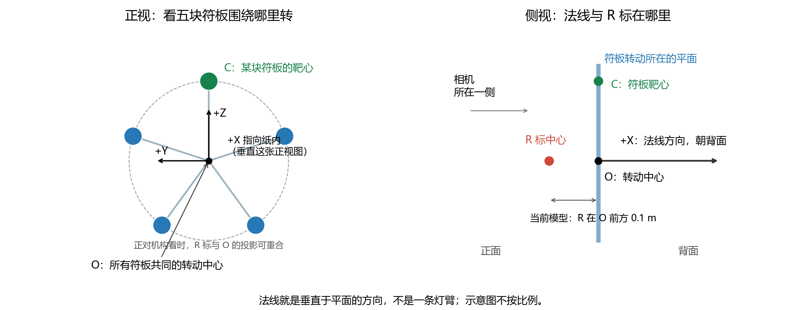
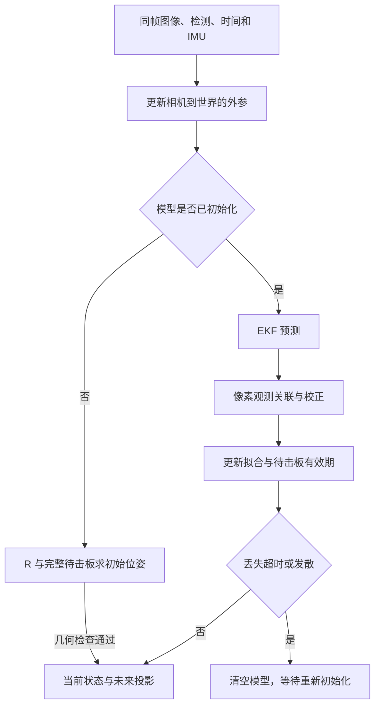

# 打符跟踪

## 符面姿态解算

### 坐标系定义

| 坐标系 | 原点 | X 轴 | Y 轴 | Z 轴 | 说明 |
|---|---|---|---|---|---|
| **符面局部系** $\{S\}$ | 所有符板共同围绕的转轴中心 O | 垂直符板平面，从正面穿向背面 | 正视零位符板时向左 | 正视零位符板时向上 | 零角度靶心位于 O 的正上方，符板绕 X 轴转动 |
| **OpenCV 光学相机系** $\{O\}$ | 相机光心 | 图像右侧 | 图像下方 | 沿光轴向前 | OpenCV PnP、投影使用此轴约定 |
| **内部相机 FLU 系** $\{C\}$ | 相机光心 | 沿光轴向前 | 向左 | 向上 | 与光学系原点相同，只有轴向不同 |
| **云台系** $\{G\}$ | 云台转轴中心 | 云台向前 | 云台向左 | 云台向上 | 相机手眼标定的目标系 |
| **IMU 体系** $\{I\}$ | IMU 中心 | 按电控约定 | 按电控约定 | 按电控约定 | 由 `R_gimbal2imubody` 连接云台体轴 |
| **世界系** $\{W\}$ | 当前云台中心 | 项目参考前方 | 项目参考左方 | 项目参考上方 | 朝向由 IMU 及固定换基确定；代码未加入底盘平移里程计 |

FLU 是 Forward、Left、Up，即前、左、上。符面局部系和相机系采用相同的右手轴约定，**不表示它们的原点或朝向相同**。

#### 转动中心是谁？法线在哪里？

**转动中心 O，就是所有符板共同围绕的那个轴心。** 把整个能量机关想成一个大风车：每块符板的靶心沿圆周运动，圆周中间不跟着符板转圈的点就是 O。它不是某块符板的小圆中心。

**法线就是垂直于符板转动平面的方向。** 把符板转动的平面想成一张纸，一根笔垂直穿过这张纸，笔的方向就是法线。它不是画面里从 R 连向某块符板的灯臂方向。



图中的三个点分别是：

| 标记 | 对应什么 | 当前代码的定义 |
|---|---|---|
| O | 所有符板共同的转动中心 | 符面局部坐标原点 $(0,0,0)$，`RuneState.x/y/z` 表示它的世界坐标 |
| R | 画面里发光的 R 标中心 | 局部 $(-0.1,0,0)$；当前模型假设它在 O 的正面一侧，突出 0.1 m |
| C | 某块符板上要击打的靶心 | 距 O 为 0.7 m，随符板绕轴转动 |

**R 标与 O 有什么关系？** 在当前物理模型中，O 位于 R 标后方 0.1 m。正对机构看时，两者在图像上的投影可以重合；从侧面看则是不同的两个点。这里的 0.1 m 来自 `kRuneIconProminentDistance`，是模型尺寸假设，不是从单张图片直接测出来的。

符面局部系的轴按下面的方式摆放：

- **+X**：从 O 垂直穿向机构背面，沿转轴方向；正视时指向纸内。
- **+Y**：零位正视图中向左。
- **+Z**：零位正视图中向上，参考符板的靶心在这条轴上。

“零角度”是模型规定的参考位置，不要求第一帧的靶心恰好就在图像正上方。实际姿态通过 PnP 求出；符面局部轴也不等于当前图像的水平、竖直方向。

#### 坐标系之间的转换关系

整体转换链与装甲板文档采用相同的读法；当前打符实现还保留一层相机轴向转换：

$$
p_{rune}\xrightarrow{\text{PnP}}p_{camera,OpenCV}
\xrightarrow{\text{换轴}}p_{camera,FLU}
\xrightarrow{\text{手眼}}p_{gimbal}
\xrightarrow{\text{IMU 姿态与换基}}p_{world}
$$

与装甲板文档一致，使用列向量，$R_{A2B}$ 表示把 A 系中的向量转换为 B 系中的向量：

$$
p_B=R_{A2B}p_A+t_{A2B}
$$

其中 $t_{A2B}$ 是 **A 系原点在 B 系中的位置**。方向向量只乘旋转，空间点还要加平移。

逆变换是先减平移，再逆旋转：

$$
p_A=R_{A2B}^{T}(p_B-t_{A2B})
$$

齐次变换与代码的 `Eigen::Isometry3d` 对应：

$$
T_{A2B}=\begin{bmatrix}R_{A2B}&t_{A2B}\\0&1\end{bmatrix}
$$

位置单位为米，像素为 px，内部角度为弧度，时间为秒。配置中的 `init_pitch_bound` 和 `diverge_face_angle` 使用度，进入计算时再换算。

#### 已知物理点与图像点序

物理尺寸定义在 [buff_types.hpp](../buff_types.hpp)：

| 符号 | 含义 | 当前值 |
|---|---|---|
| $r$ | 机构中心到靶心的距离 | 0.7 m |
| $a$ | 靶心到十字端点的距离 | 0.15 m |
| $d$ | R 相对符板平面的突出距离 | 0.1 m |

初始化时，以作为种子的待击板为零角度板，使用以下五个三维点：

$$
P_{icon}=\begin{bmatrix}-d\\0\\0\end{bmatrix},\quad
P_T=\begin{bmatrix}0\\0\\r+a\end{bmatrix},\quad
P_L=\begin{bmatrix}0\\a\\r\end{bmatrix},\quad
P_B=\begin{bmatrix}0\\0\\r-a\end{bmatrix},\quad
P_R=\begin{bmatrix}0\\-a\\r\end{bmatrix}
$$

PnP 点序为 **R 标、外端 T、左端 L、内端 B、右端 R**。其中右端 R 与机构 R 标是不同的点。

`SingleRunePnpSolution::image_points(board, icon)` 根据四端点到 R 标的距离找内端、外端，再按侧向投影区分左、右。因此：

- 四端点是实际灯排的物理端点，不是检测框四角。
- “上、下”是相对机构半径方向的定义，不是图像竖直方向。
- `board.center` 用于辅助端点排序和后续几何验证，五点 PnP 中没有额外加入靶心作为第六点。
- 网络点序先经检测模块适配为公共观测，不能直接把网络数组下标当作 PnP 点序。

#### 相机内参与像素坐标

相机内参为：

$$
K=\begin{bmatrix}f_x&0&c_x\\0&f_y&c_y\\0&0&1\end{bmatrix}
$$

无畸变针孔模型为：

$$
u=f_x\frac{X_O}{Z_O}+c_x,\qquad
v=f_y\frac{Y_O}{Z_O}+c_y
$$

$f_x,f_y$ 和主点 $c_x,c_y$ 的单位均为像素。五参数畸变按 $[k_1,k_2,p_1,p_2,k_3]$ 读取，实际投影由 OpenCV 处理。

检测点必须先撤销网络输入的缩放、填边，回到**原图像素坐标**，再使用原图内参。网络输入尺寸不是相机标定尺寸。当前相机读取代码没有按图像尺寸自动缩放内参的功能。

一个已去畸变的像素只能确定一条射线，不能单独确定三维距离：

$$
p_O=\lambda\begin{bmatrix}x_n\\y_n\\1\end{bmatrix},\qquad \lambda>0
$$

PnP 结合多个图像点及已知物理尺寸，才可以恢复空间尺度。

#### 具体转换步骤

##### 1. PnP 解算：符面局部坐标系 → 相机坐标系

源码先将符面模型点从 FLU 换为光学轴约定，再执行 `SOLVEPNP_EPNP`，随后用 `SOLVEPNP_ITERATIVE` 优化。

定义换轴矩阵，与源码 `R_opencv2flu` 一致：

$$
A=R_{opencv2flu}=\begin{bmatrix}0&0&1\\-1&0&0\\0&-1&0\end{bmatrix}
$$

于是：

$$
p_C=Ap_O=(Z_O,-X_O,-Y_O)^T,\qquad
p_O=A^Tp_C=(-y_C,-z_C,x_C)^T
$$

PnP 使用的物体点是 $p_{S_O}=A^Tp_S$，输出满足：

$$
p_O=R_{pnp}p_{S_O}+t_{pnp},\qquad
R_{pnp}=\operatorname{Rodrigues}(rvec)
$$

恢复为本模块的 FLU 位姿：

$$
R_{rune2camera}=A R_{pnp}A^T,\qquad
\texttt{xyz\_in\_camera}=A t_{pnp}
$$

**为什么旋转矩阵两侧都要乘？** 这里同时改变了物体轴和相机轴；位置向量只需要左乘 $A$，旋转矩阵需要两侧换基。

符面局部系原点是机构中心，因此 `xyz_in_camera` 是机构中心在相机 FLU 系中的位置，不是相机在符面系中的位置。

代码入口对应：

```cpp
SingleRunePnpSolution pnp;
if (!pnp.solve(board, icon.center, camera_matrix, distort_coeffs))
    return std::nullopt;

const auto xyz_in_camera = pnp.result.xyz_in_camera;
const auto q_rune2camera = pnp.result.q_rune2camera;
```

PnP 返回成功后，还需要验证五点重投影误差、法线朝向、符面倾角以及其他待击板布局。当前初始化要求 1～2 块待击板和至少一个 R 候选；仅有激活圆环不能初始化模型。

##### 2. 手眼标定：相机坐标系 → 云台坐标系

[pose/rune_camera.cpp](pose/rune_camera.cpp) 在内部读取相机 YAML：

```yaml
calibration:
  camera_matrix: [...]       # 3×3，按行排列
  distort_coeffs: [...]      # k1、k2、p1、p2、k3
handeye_calibration:
  R_camera2gimbal: [...]     # OpenCV 光学系到云台系
  t_camera2gimbal: [...]     # 相机光心在云台系中的位置，米
  R_gimbal2imubody: [...]    # 云台体轴到 IMU 体轴
```

这里的省略号仅表示字段结构，不能直接作为运行配置。标定板行列数、圆心距等用于生成标定结果，不参与本模块的打符 PnP。

令配置中的 $H=R_{camera2gimbal}$、$t=t_{camera2gimbal}$。因为配置中的相机轴为 OpenCV 光学轴，而内部点已经是 FLU，需要：

$$
R_{C2G}=H A^T
$$

$$
p_G=H A^T p_C+t
$$

平移 $t$ 本来就用云台系表达，不能再乘相机换轴矩阵。源码内部的 `T_camera2gimbal_` 接收的是相机 FLU 点，不能与 YAML 中的光学轴旋转直接混用。

##### 3. 相似变换（旋转换基）：云台坐标系 → 世界坐标系

令 $B=R_{gimbal2imubody}$，$Q$ 为串口 IMU 四元数对应的旋转矩阵。当前 `gimbal_orientation()` 使用：

$$
R_{gimbal2world}=B^T Q B
$$

与装甲板模块一样，右侧 $B$ 转换体轴，左侧 $B^T$ 转换参考轴。这里 $Q$ 的参考轴与项目世界参考轴不同，不能把左侧 $B^T$ 理解为“回到当前云台体坐标系”。该公式按当前电控与工程约定使用，不是所有 IMU 都可直接套用的通式。

组合手眼外参：

$$
R_{camera2world}=R_{gimbal2world}H A^T
$$

$$
t_{camera2world}=R_{gimbal2world}t
$$

因此：

$$
\boxed{p_W=R_{gimbal2world}(H A^Tp_C+t)}
$$

也可以从光学相机点直接出发：

$$
p_W=R_{gimbal2world}(H p_O+t)
$$

**相机偏移也要随云台旋转。** 只旋转朝向而不旋转手眼平移，会使云台转动时计算出的目标位置漂移。

当前代码没有额外加入云台中心在场地中的平移，因此不是固定原点的完整场地定位。四元数必须对应图像曝光时刻，由上层完成姿态时间匹配，再调用 `set_imu_orientation()`。

##### 4. 从初始位姿提取机构中心、符面偏航和转角

将 PnP 位姿转到世界系：

$$
c_W=R_{camera2world}\,\texttt{xyz\_in\_camera}+t_{camera2world}
$$

$$
R_{rune2world}=R_{camera2world}R_{rune2camera}
$$

取第一列 $n=R_{rune2world}[:,0]$，即符面 X 轴法线：

$$
\psi=\operatorname{atan2}(n_y,n_x),\qquad
\beta=\arcsin(|n_z|)
$$

$\psi$ 是符面法线在世界水平面内的偏航角；$\beta$ 用于检查符面倾角。跟踪状态只保留 $\psi$，没有继续维护完整三轴符面姿态。

消去偏航后，取种子板绕局部 X 轴的转角：

$$
M=R_z(-\psi)R_{rune2world},\qquad
\theta=\operatorname{atan2}(-M_{1,2},M_{2,2})
$$

矩阵下标从 0 开始。此处不能直接用图像中 R 到靶心的二维夹角代替，因为透视、相机姿态会改变图像角度。

##### 5. 数字例子：核对换轴与手眼顺序

假设光学系点为 $(0.2,-0.1,3)$ m，表示目标在右侧 0.2 m、上方 0.1 m、前方 3 m。

换为相机 FLU：

$$
p_C=(3,-0.2,0.1)^T
$$

若理想安装 $H=A$，相机光心在云台系的位置为 $t=(0.1,0,0)^T$，则：

$$
p_G=(3.1,-0.2,0.1)^T
$$

云台绕世界 Z 轴转 $90^\circ$ 后：

$$
p_W=R_z(90^\circ)p_G=(0.2,3.1,0.1)^T
$$

这些是教学数字，不是本机标定值。反算时应先逆云台旋转，再减手眼平移，最后逆手眼旋转，才能回到最初的光学点。

## 空间模型与 EKF 跟踪

### 状态定义及板心投影

EKF 状态顺序固定为：

$$
s=(x,y,z,\omega,\theta,\psi)^T
$$

其中 $(x,y,z)$ 为机构中心，$\omega$ 为角速度，$\theta$ 为连续自转角，$\psi$ 为符面偏航。$\theta$ 不在每帧折回 $[-\pi,\pi]$，便于拟合连续运动。

第 $i$ 块符板，$i=0,1,2,3,4$，对应：

$$
\alpha_i=\theta+\frac{2\pi i}{5},\qquad
l_i=\begin{bmatrix}0\\-r\sin\alpha_i\\r\cos\alpha_i\end{bmatrix}
$$

$$
p_{W,i}=c_W+R_z(\psi)l_i
$$

五个板位相差 $72^\circ$。R 标使用 $l_{icon}=(-d,0,0)^T$，不随自转角改变局部位置。

从世界点投影回原图：

$$
p_C=R_{camera2world}^T(p_W-t_{camera2world}),\qquad
p_O=A^Tp_C,\qquad
\hat z=\pi(K,D,p_O)
$$

$\pi$ 表示带畸变的相机投影，$\hat z$ 是预测像素坐标。光学深度 $Z_O$ 必须大于 0.1 m；对应相机 FLU 中的 $x_C>0.1$ m。

### 预测、关联与校正

**预测：** 相邻帧间隔为 $\Delta t$，当前 EKF 使用恒角速度模型：

$$
\theta_k^-=\theta_{k-1}+\omega_{k-1}\Delta t
$$

$$
F=I,\quad F_{\theta,\omega}=\Delta t,\qquad P^-=FPF^T+Q
$$

当前实现直接加配置的过程噪声 $Q$，没有额外按 $\Delta t$ 离散化。即使未来预测选择了正弦模型，EKF 自身仍按上式推进。

**关联：** 观测像素 $z_i$ 与特征投影 $h_j(s^-)$ 的平方马氏距离为：

$$
e_{ij}=z_i-h_j(s^-),\quad
S_j=H_jP^-H_j^T+R_{obs},\quad
d_{ij}^2=e_{ij}^TS_j^{-1}e_{ij}
$$

匈牙利算法按此代价匹配，并通过门限拒绝不合适的候选。R 只能匹配特征 0，符板中心只能匹配板位 1～5；检测数组下标不是固定板位编号。

**校正：** 每个被接受的二维观测依次更新状态：

$$
K_{gain}=P^-H^T(HP^-H^T+R_{obs})^{-1}
$$

$$
s^+=s^-+K_{gain}(z-h(s^-))
$$

$$
P^+=(I-K_{gain}H)P^-(I-K_{gain}H)^T+K_{gain}R_{obs}K_{gain}^T
$$

$K_{gain}$ 是卡尔曼增益，与相机内参 $K$ 不同。$R_{obs}$ 越大，表示越不相信像素观测。

当前均值投影包含畸变，但观测雅可比采用针孔近似：

$$
J_\pi=\begin{bmatrix}f_x/Z&0&-f_xX/Z^2\\0&f_y/Z&-f_yY/Z^2\end{bmatrix}
$$

$$
H\approx J_\pi A^T R_{camera2world}^T\frac{\partial p_W}{\partial s}
$$

### 哪些观测能参与跟踪

| 观测 | 初始化 PnP | 初始化后校正 | 标记为可击打 |
|---|---|---|---|
| R 候选 | 与完整待击板配对 | 校正 R 的投影 | 否 |
| 完整待击板 | 作为种子板 | 使用靶心像素校正 | 是 |
| 缺少端点的待击板 | 不能作为首次初始化输入 | 可以使用中心校正 | 是 |
| 小符激活圆环 | 不能作为种子板 | 可以使用中心校正 | 否 |
| 大符激活灯臂 | 不能把灯臂四点当成待击板四端点 | 先重建靶心，再使用中心校正 | 否 |

这里描述几何路径，实际观测还必须通过颜色筛选、数值检查和关联门限。四端点主要用于初始位姿和几何检查，正常 EKF 更新主要使用 R 和靶心像素，不是每帧都重新做全部符板 PnP。

当前有两种不同的“丢失”：

- **待击板有效期**：某板位被待击观测校正后，有效期为 100 ms；过期后不再作为当前瞄准候选。
- **模型丢失**：超过 `lost_timeout_s` 没有待击板校正，或模型发散，清空模型。默认超时为 1.5 s。

仅 R 或激活目标校正可以帮助稳定模型，但不会刷新待击板丢失计时。无检测时仍推进 EKF 和协方差，不把预测点重新作为真实样本送入拟合。

## 大符激活灯臂的几何重建

### 模型与坐标系

深大灯臂的 56 个模型点位于 [szu_light_arm_model.hpp](pose/szu_light_arm_model.hpp)。点表已一次性从原 SZU 坐标转换为符面局部 FLU：

$$
(x,y,z)_{SZU}\longrightarrow(z,-x,-y)_{FLU}
$$

运行时不再在 SZU 和 FLU 之间反复转换。`szu_light_arm_model` 的名字说明模型来源，不表示点表仍使用 SZU 坐标。

- 灯臂平面：局部 $x=-0.0111$ m。
- R 点：局部 $(-d,0,0)$。
- 零角度靶心：局部 $(0,0,r)$。
- 自转：绕局部 X 轴，转角正方向与原深大模型一致。

投影任意灯臂模型点：

$$
p_C=R_{rune2camera}R_x(\theta)p_{model}+c_C
$$

其中 $c_C$ 是机构中心在相机 FLU 中的位置。点表已经包含灯臂的 11.1 mm 偏移，不再额外叠加。

### 射线求交与转角初值

先用本帧 R 和完整待击板求符面位姿，再将网络给出的灯臂关键点去畸变。光学归一化点 $(u_n,v_n)$ 对应相机 FLU 射线：

$$
l_C=(1,-u_n,-v_n)^T
$$

灯臂平面的相机系法线与平面上一点为：

$$
n_C=R_{rune2camera}(1,0,0)^T,\qquad
o_C=c_C-0.0111n_C
$$

射线与平面相交：

$$
\lambda=\frac{n_C^To_C}{n_C^Tl_C},\qquad
p_S=R_{rune2camera}^T(\lambda l_C-c_C)
$$

射线的 X 分量为 1，因此 $\lambda$ 是相机前向深度，单位米，不是沿射线的欧氏距离。

对有效关键点的局部 Y、Z 分量取平均，得到转角初值：

$$
\theta_0=\operatorname{atan2}(-\bar y,\bar z)
$$

这是因为绕 X 轴旋转时，零位 $+Z$ 方向变为 $y=-r\sin\theta$、$z=r\cos\theta$。

### 轮廓匹配与输出

关键点仅提供转角初值。代码围绕初值搜索 $\pm30^\circ$，先以 $1^\circ$ 搜索，再用更小步长细化；每次将灯臂模型投影到原图，与实测轮廓的距离图比较。

匹配成功要求包括：模型点支持比例至少 0.8、轮廓距离 RMS 不超过像素门限的 0.75 倍，并通过搜索边界及相邻角度歧义检查。

最终靶心由物理半径恢复：

$$
p_{C,bullseye}=R_{rune2camera}R_x(\theta)(0,0,r)^T+c_C
$$

再投影到原图，输出 `Appearance::big_activated` 的中心观测，不伪造四端点。它可参与同一套 EKF 校正，但不会成为待击板。

**这里恢复的是对应符板的靶心，不是机构转动中心。** 缺少同帧 R 或可用完整待击板时，不用历史预测硬补符面。

## 运动拟合与未来状态

### 恒速与正弦模型

拟合输入是实际符板校正后的连续转角和时间。仅 R 校正或纯预测帧不添加样本。

恒速模型：

$$
\theta(t)\approx C+vt,\qquad
\theta(t+\tau)=\theta(t)+v\tau
$$

正弦角速度模型：

$$
\omega(t)=v+a\sin\phi(t),\qquad
\phi(t+\tau)=\phi(t)+\Omega\tau
$$

对角速度积分，得到：

$$
\theta(t+\tau)=\theta(t)+v\tau+
\frac{a}{\Omega}\left[\cos\phi(t)-\cos(\phi(t)+\Omega\tau)\right]
$$

$\Omega$ 是角速度振荡的频率参数，不是机构当前角速度 $\omega$。源码在 $|\Omega|$ 很小时回退恒速积分。

拟合数学实现位于 [rune_energy_fitter.cpp](../../rm_utils/algorithm/rune_energy_fitter.cpp)。当前正弦拟合采用参考深大的可分离 LM–IRLS；窗口为 6 s，最短跨度为 1.5 s。预测器跳过初始化后的首秒，再向拟合器提交样本。

`RunePredictor` 比较恒速与正弦代价；同帧有多个待击板校正时，还有 3 s 的正弦优先窗口。**当前不是单纯根据电控大小符模式强制二选一**。拟合结果用于导出角速度及未来外推，不反写 EKF 六维后验。没有可用拟合时，导出角速度回退到 EKF 估计。

### 瞄准点与时间

`RuneState::get_aimpoints()` 先检查预热：恒速路径 3 s，正弦路径 6 s；再按固定板位顺序选择首个仍有效的待击板。

预测只修改状态副本，不提前推进当前 EKF。未来世界系板心仍使用前面的五板几何公式；`prediction_seconds` 控制跟踪结果中的未来投影时长，不等于实际弹道飞行时间。

跟踪输出的空间点交给 [rune_shooter.cpp](../buff_shoot/rune_shooter.cpp) 处理弹道、处理延迟和飞行时间。不要把简单的几何方位角直接当作完整火控结果。

一帧的图像、检测、姿态和时间必须对应同一次曝光。回放应使用记录或媒体时间；暂停、单步及回放倍速不应改变模型中的物理时间间隔。

## 使用方式与排查

### 对外调用

```cpp
// 构造时读取跟踪配置，相机 YAML 由 pose 内部加载。
auto_buff::RmcsTracker tracker(track_config_path, camera_config_path);

// 每帧先更新曝光姿态，再提交对应检测和曝光时间。
tracker.set_imu_orientation(q_imubody2world);
auto result = tracker.update(detection, exposure_seconds, image);
```

| 结果 | 含义 |
|---|---|
| `initialized` | 当前存在有效空间模型 |
| `observed` | 本帧初始化成功，或有观测通过关联和校正 |
| `ready` | 预热完成，且存在仍有效的待击板 |
| `state` | 当前导出状态；角速度可能来自拟合 |
| `ekf` | 原始 EKF 后验及协方差对角项 |
| `matched` / `predicted` | 本帧接受的像素观测 / 本轮校正前投影 |
| `future` | 指定预测时长后的五个板位投影 |

`initialized` 不等于允许发射；`ready` 也不能替代 shoot 的有效性判断。

### 常见问题

| 现象 | 优先检查 |
|---|---|
| 静止时正常，云台转动时目标漂移 | 曝光姿态是否对应、IMU 换基、手眼平移是否一起旋转 |
| 左右或上下反了 | 光学系与 FLU 的转换方向、是否重复换轴 |
| 距离相差约 1000 倍 | 毫米与米混用、模型尺寸单位 |
| 五点看着正常但 PnP 不稳定 | 端点物理含义、R 突出量、点序、原图内参 |
| 有检测却不能初始化 | 是否存在完整待击板及 R，待击板是否超过两块，几何检查是否通过 |
| 圆环能稳定跟踪却不能瞄准 | 激活目标可校正模型，但不是待击目标 |
| 大符灯臂有四点却没有重建靶心 | 同帧种子板和 R、轮廓提取、灯臂匹配质量 |
| 短时没检测仍显示投影 | 模型处于预测阶段，投影不代表本帧检测成功 |

在已经按主工程配置好的 Linux 构建目录中，可单独构建和执行相关测试：

```bash
cmake --build build --target buff_camera_test buff_pose_test buff_track_test buff_predict_test
ctest --test-dir build -R '^buff_(camera|pose|track|predict)_test$' --output-on-failure
```

这些测试验证相机换基、PnP、灯臂几何、跟踪与预测的代码行为。合成数据通过不代表实际相机标定、机械尺寸或实机命中率已经验收。

## 附录：模块职责与处理流程

本模块沿用 RMCS 的空间模型和 EKF，接收检测模块提供的 R、符板和灯臂观测，输出当前空间状态及未来符板位置。大符激活灯臂采用深大模型轮廓匹配，但重建出的靶心仍交给同一套 RMCS 跟踪模型。

| 文件 | 作用 |
|---|---|
| [track/buff_tracker.cpp](track/buff_tracker.cpp) | 对外入口 `RmcsTracker`，组织观测、初始化、丢失和重建 |
| [pose/rune_camera.cpp](pose/rune_camera.cpp) | 读取相机标定，将曝光时刻 IMU 姿态组合为相机外参 |
| [pose/rune_pnp.cpp](pose/rune_pnp.cpp) | 根据 R 整理端点顺序，求初始相机系位姿 |
| [pose/rune_pose.cpp](pose/rune_pose.cpp) | 遍历 R 与种子板，验证几何并选择初始空间解 |
| [pose/rune_projection.cpp](pose/rune_projection.cpp) | 将机构中心、转角和符面偏航投影成 R 与五个板心 |
| [pose/big_activated.cpp](pose/big_activated.cpp) | 用大符激活灯臂轮廓恢复对应靶心的像素位置 |
| [track/rune_model.cpp](track/rune_model.cpp) | 六维 EKF、观测关联、待击板有效期 |
| [predict/rune_predictor.cpp](predict/rune_predictor.cpp) | 维护拟合样本，选择恒速或正弦模型，生成未来投影 |
| [predict/rune_state.cpp](predict/rune_state.cpp) | 状态外推、世界系瞄准点和运动前馈 |
| [track_types.hpp](track_types.hpp) | 公共状态、拟合参数、几何门限及关联结果 |



大符灯臂的靶心重建发生在观测组织阶段，需要本帧 R 和完整待击板建立符面；不能只靠历史 EKF 位姿恢复灯臂靶心。
