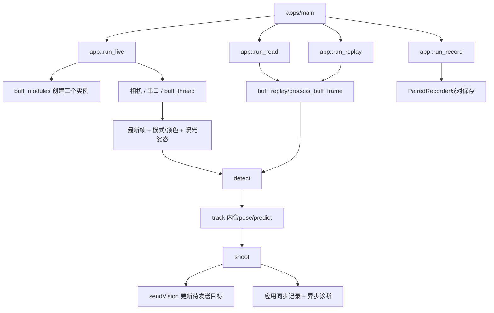

> 此文记录合并前的历史结构。2026-11-13当前入口与并发边界见[接入说明](INTEGRATION_20261113.md)和[apps](../apps/README.md)。

# 当前代码结构与分层说明

更新：2026-11-11。目录按当前磁盘文件与实际调用关系核对。逐文件职责见[文件说明](CODE_FILE_GUIDE_20261109.md)，编译运行以[Linux说明](../README_LINUX.md)为准，历史实测与研究依据见[性能记录](PERFORMANCE.md)。

## 1. 当前目录与职责

```text
mas_buff/
├── apps/                                                     # 功能入口和资源装配
│   ├── buff/                                                 # 实机、媒体、录制、回放及会话支持
│   │   ├── README.md                                         # 应用入口与资源装配说明
│   │   ├── RECORDING.md                                      # 录制格式、配对姿态和统计约定
│   │   ├── REPLAY.md                                         # 配对检查、回放、暂停和单步说明
│   │   ├── live.cpp                                          # 实机资源装配，启动三个任务、轮询显示、写报告并统一退出
│   │   ├── live.hpp                                          # 声明 app::run_live 实机入口。
│   │   ├── preview.hpp                                       # 按 YAML 与输出目录配置 Display 并负责关闭；带会话路径/控制台提示，属于应用装配性质的辅助代码。
│   │   ├── read.cpp                                          # 读取普通媒体，调用离线单帧算法并导出报告/叠图
│   │   ├── read.hpp                                          # 声明 app::run_read 普通媒体处理及导出入口。
│   │   ├── record.cpp                                        # 仅采集图像和配对姿态，保存标定/模型快照及replay.yaml
│   │   ├── record.hpp                                        # 声明 app::run_record 独立采集入口。
│   │   ├── replay.cpp                                        # 回放成对图像与 CSV，检查数据一致性，按记录时间驱动算法，处理暂停/继续/单步与导出；check 分支不创建算法。
│   │   ├── replay.hpp                                        # 声明 app::run_replay；check_only 控制仅检查配对。
│   │   ├── session.cpp                                       # 复制本次算法、设备、标定配置，并整理模型和资源引用，生成可回放的会话配置。
│   │   └── session.hpp                                       # 声明采集会话的配置快照保存函数。
│   ├── CMakeLists.txt                                        # 构建五个应用流程实现的 buff_app，再用 main.cpp 生成 mas_buff。
│   └── main.cpp                                              # 定义进程级g_shutdown；解析命令和配置路径，分派run/read/export/record/replay/check并统一报告异常。record仅采集，export负责导出。
├── threads/                                                  # 长期任务；借用应用创建的算法对象
│   ├── buff_thread/                                          # 实机逐帧业务编排
│   │   ├── buff_thread.cpp                                   # 实机模式/颜色与姿态有效性处理、最新帧/帧龄控制、detect→track→shoot、串口目标发布；包含业务策略，不只是线程启动器。
│   │   └── buff_thread.hpp                                   # 声明 FramePose、SynchronizedResult、实机任务入口及发布回调；同时extern引用由apps/main定义的退出标志。
│   ├── hikcamera_thread/                                     # 海康图像生产任务
│   │   ├── hikcamera_thread.cpp                              # 初始化并消费海康驱动，将 CameraFrame 推入应用 SPSC 队列，响应退出与设备异常。
│   │   └── hikcamera_thread.hpp                              # 声明海康采集任务及退出标志。
│   ├── serial_thread/                                        # 周期串口收发任务
│   │   ├── serial_thread.cpp                                 # 引用进程级g_shutdown，周期性发送/接收 UserSerial 数据，结束时关闭串口；此全局还被底层串口业务类引用。
│   │   └── serial_thread.hpp                                 # 声明串口收发服务任务及退出标志。
│   ├── usbcamera_thread/                                     # 保留的公共USB图像任务
│   │   ├── usbcamera_thread.cpp                              # 消费 USB 相机图像并生成 CameraFrame，推入 SPSC 队列，响应退出。
│   │   └── usbcamera_thread.hpp                              # 声明 USB 相机采集任务及退出标志。
│   ├── CMakeLists.txt                                        # 把相机/串口/实机业务任务聚为一个静态库，依赖硬件与算法装配。
│   ├── README.md                                             # 线程和队列归属说明
│   └── frame_pool.hpp                                        # take_latest_frame 从单生产者/单消费者相机队列丢弃旧帧、取最新帧，限制实时积压。
├── auto_buff/                                                # 打符业务代码
│   ├── buff_detect/                                          # 图像到统一二维观测
│   │   ├── traditional/                                      # RMCS传统检测适配
│   │   │   ├── rmcs/                                         # 移植的传统检测与来源许可
│   │   │   │   ├── compat/                                   # 骨架细化兼容实现
│   │   │   │   │   ├── LICENSE                               # 对应上游代码许可证
│   │   │   │   │   ├── thinning.cpp                          # 本地实现骨架细化，避免为这一操作引入完整额外 OpenCV 扩展模块。
│   │   │   │   │   └── thinning.hpp                          # 声明 RMCS 适配需要的二值图像细化接口。
│   │   │   │   ├── LICENSE                                   # 对应上游代码许可证
│   │   │   │   ├── PORTING.md                                # 传统检测移植差异和适用范围
│   │   │   │   ├── SOURCE.json                               # RMCS传统检测的来源记录
│   │   │   │   ├── rune.cpp                                  # 执行色差分割、R骨架识别、符板轮廓与几何筛选，生成传统观测；属于实际传统算法。
│   │   │   │   └── rune.hpp                                  # 声明传统 RuneDetector、参数及轮廓/R骨架检测所需结构。
│   │   │   ├── traditional.cpp                               # 加载用于物理尺寸筛选的相机参数，把 RMCS 传统检测输出转为公共 Detection；不调用跟踪。
│   │   │   └── traditional.hpp                               # 声明传统检测适配器 TraditionalDetector。
│   │   ├── yolo/                                             # 三类五点YOLO及像素几何/精修
│   │   │   ├── model/                                        # 模型候选和来源；仅加载配置选择的文件
│   │   │   │   ├── SZU_LICENSE.txt                           # 深大模型许可证
│   │   │   │   ├── SZU_MODEL.json                            # 模型来源、接口和哈希记录
│   │   │   │   ├── rune_pose_best_int8_640.bin               # 历史候选模型，须满足当前三类五点I/O后才能使用
│   │   │   │   ├── rune_pose_best_int8_640.xml               # 历史候选模型，须满足当前三类五点I/O后才能使用
│   │   │   │   ├── rune_pose_best_int8_640.zip               # 旧交付压缩包，程序不直接加载ZIP
│   │   │   │   ├── rune_szu.onnx                             # 深大三类五点基准ONNX；配置中的默认模型路径
│   │   │   │   ├── rune_szu_public_int8.bin                  # 公开视频标定的INT8试验模型；XML图与BIN权重成对使用
│   │   │   │   └── rune_szu_public_int8.xml                  # 公开视频标定的INT8试验模型；XML图与BIN权重成对使用
│   │   │   ├── AI时代的训练工程_种子与确定性.md              # 种子、确定性与训练工程通识，不参与运行
│   │   │   ├── README.md                                     # 模型协议、观测约定及训练部署说明
│   │   │   ├── pixel_geometry.cpp                            # 以网络点作搜索先验，提取并筛选真实像素轮廓、测量颜色；颜色判定与按已知颜色提轮廓是不同操作。
│   │   │   ├── pixel_geometry.hpp                            # 声明红蓝颜色采样、ROI 色差轮廓、板面轮廓选择和灯臂轮廓提取接口。
│   │   │   ├── pixel_refiner.cpp                             # 利用实测轴线/轮廓修正板心和端点，按整组精修或回退；不靠对称关系凭空补缺失端点，不修改网络类别。
│   │   │   ├── pixel_refiner.hpp                             # 声明板面与网络五点的像素精修接口及成功/回退约定。
│   │   │   ├── pose_output.cpp                               # 执行类别/点分数门限、原图坐标还原、分组去重及三类观测转换；保留 raw_poses，按需调用像素处理。
│   │   │   ├── pose_output.hpp                               # 声明三类五点输出解码、四端点收集和公共观测生成接口。
│   │   │   ├── yolo.cpp                                      # 读取auto_buff.detect，执行letterbox/RGB/NCHW、OpenVINO同步推理和观测转换
│   │   │   └── yolo.hpp                                      # 声明接收业务配置路径的YOLO检测器及复用推理资源
│   │   ├── CMakeLists.txt                                    # 显式登记传统和 YOLO 检测源码及 OpenVINO/公共工具依赖。
│   │   ├── detection.cpp                                     # 验证 red/blue 输入；按颜色及小/大符模式筛选观测，保留原始网络候选用于诊断。
│   │   └── detection.hpp                                     # 定义 Detector 接口、RuneMode、Appearance 及 R/板面/原始五点/灯臂/Detection 观测协议。
│   ├── buff_replay/                                          # 离线单帧算法调用，实机不走此入口
│   │   ├── buff_replay.cpp                                   # 普通媒体/成对回放的单帧 detect→筛选→姿态→track→shoot 编排与计时；不打开设备、不发送串口、不显示。实机当前不走此函数。
│   │   └── buff_replay.hpp                                   # 定义 BuffFrame（图像、时间、可选姿态、颜色和模式）及 process_buff_frame 两个重载。
│   ├── buff_shoot/                                           # 未来瞄准、弹道和发弹节奏
│   │   ├── CMakeLists.txt                                    # 构建火控并依赖 buff_track；不链接串口设备。
│   │   ├── rune_shooter.cpp                                  # 结合运动预测、弹道飞行时间、发射延迟及偏置迭代求瞄准角，按 idle/shoot 节奏给出 should_shoot；不直接发送协议包。
│   │   └── rune_shooter.hpp                                  # 声明 RuneShooter、Aimed、时刻更新和重置接口；PImpl 隐藏计算状态。
│   ├── buff_track/                                           # 跟踪入口与pose/track/predict子层
│   │   ├── pose/                                             # 标定变换、PnP、灯臂板心恢复和重投影
│   │   │   ├── big_activated.cpp                             # 结合本帧待击板给出的符面位姿、灯臂模板与实测轮廓恢复板心，并验证几何一致性；不是另一个跟踪器。
│   │   │   ├── big_activated.hpp                             # 声明大符灯臂到符板中心的几何恢复接口。
│   │   │   ├── big_activated_SOURCE.json                     # 大符几何与深大灯臂模型来源记录
│   │   │   ├── rune_camera.cpp                               # 加载标定、核对图像尺寸、应用相机/云台/IMU 坐标关系，为位姿与投影提供同一相机几何。
│   │   │   ├── rune_camera.hpp                               # 声明相机内参、畸变、手眼与 IMU 姿态变换的持有及查询接口。
│   │   │   ├── rune_pose.cpp                                 # 组织 PnP 种子并求解，检查重投影、符面姿态与机构布局，输出初始化 RunePose。
│   │   │   ├── rune_pose.hpp                                 # 声明以真实 R 与待击板端点求初始空间位姿的接口。
│   │   │   ├── rune_projection.cpp                           # 将 R 和五个板位从机构/世界系变到相机图像，供关联、校正和初始化检查使用。
│   │   │   ├── rune_projection.hpp                           # 声明当前状态的机构特征投影及相关几何计算接口。
│   │   │   └── szu_light_arm_model.hpp                       # 保存深大灯臂的 56 个三维模板点，供大符灯臂几何恢复使用；属于模型常量。
│   │   ├── predict/                                          # 转角拟合选择、状态外推及瞄准点
│   │   │   ├── rune_predictor.cpp                            # 维护真实校正样本，比较恒速与正弦拟合并返回预测参数；不独立持有第二套 EKF。
│   │   │   ├── rune_predictor.hpp                            # 声明转角样本窗口、运动拟合与未来特征预测接口。
│   │   │   └── rune_state.cpp                                # 实现 RuneState 恒速/正弦积分、预热后的待击板瞄准点与方向前馈，以及状态副本的未来像素投影。声明分别在 buff_state.hpp/rune_predictor.hpp。
│   │   ├── track/                                            # 状态估计、关联校正和模型生命周期
│   │   │   ├── buff_tracker.cpp                              # 将公共检测转为 RMCS 特征，组织大符几何恢复、初始化、预测/校正、超时/重置及未来投影；消费本帧姿态。
│   │   │   ├── buff_tracker.hpp                              # 声明 RmcsTracker 与 TrackResult；管理每帧观测、生命周期和诊断快照。
│   │   │   ├── rune_model.cpp                                # 持有六维状态与协方差，执行预测、投影关联、匈牙利分配、马氏代价和观测校正，维护拟合及发散检查。
│   │   │   └── rune_model.hpp                                # 声明 RMCS RuneModel 模型接口，以 PImpl 隐藏 EKF 实现。
│   │   ├── CMakeLists.txt                                    # 显式登记 pose/track/predict 源码，链接公共数学和工具；检测类型依赖还体现在头文件 include。
│   │   ├── README.md                                         # pose/track/predict划分说明
│   │   └── buff_state.hpp                                    # 定义 RuneState、初始化位姿、拟合结果、EKF 快照、配置和诊断特征；明确像素/米/弧度与状态顺序。
│   ├── debug/                                                # 打符结果快照、绘制、报告和耗时
│   │   ├── blueprints/                                       # Rerun布局资源和生成工具
│   │   │   ├── 1.rbl                                         # detect布局资源
│   │   │   ├── 2.rbl                                         # track布局资源
│   │   │   ├── 3.rbl                                         # detect＋track布局资源
│   │   │   ├── 4.rbl                                         # shoot布局资源
│   │   │   ├── 5.rbl                                         # detect＋shoot布局资源
│   │   │   ├── 6.rbl                                         # track＋shoot布局资源
│   │   │   ├── 7.rbl                                         # detect＋track＋shoot布局资源
│   │   │   └── generate.py                                   # 生成 1～7 组合的 Rerun .rbl 布局：各模块图像、按同类分组的曲线；仅改布局时需要 Python，运行程序不需要。
│   │   ├── visualize/                                        # 三阶段结果转文字/图元，不运行算法
│   │   │   ├── annotation.cpp                                # 在普通图像上合成三阶段结果，服务同步标注视频导出；与实时显示后端分开。
│   │   │   ├── annotation.hpp                                # 声明用于导出录像的叠图函数。
│   │   │   ├── detect_debug.cpp                              # 生成检测状态、颜色、原始/精修点与置信度/数量曲线；不运行检测。
│   │   │   ├── detect_debug.hpp                              # 声明 DetectDebug 检测绘制接口。
│   │   │   ├── shoot_debug.cpp                               # 生成瞄准角、云台角、飞行时间、预测时长及开火建议的文字/曲线/图形。
│   │   │   ├── shoot_debug.hpp                               # 声明 ShootDebug 火控绘制接口。
│   │   │   ├── track_debug.cpp                               # 生成当前关联前投影、接受观测、未来投影、EKF/拟合/协方差文本及同类曲线；不修改模型。
│   │   │   └── track_debug.hpp                               # 声明 TrackDebug 跟踪绘制接口。
│   │   ├── README.md                                         # 打符专属诊断说明
│   │   ├── buff_debug.cpp                                    # 按模块 debug 选择绘制内容；复制一份底图并异步消费，实机覆盖旧待处理帧、离线等待保序；计算生产者 Process FPS。
│   │   ├── buff_debug.hpp                                    # 声明诊断快照、异步工作线程、提交接口和队列/耗时统计。
│   │   ├── performance.hpp                                   # PerformanceLog 按 runtime.profile 写 performance.csv；汇总各阶段和 YOLO 细分耗时、输出开销与结果年龄，不依赖 Viewer 上屏。
│   │   ├── report.cpp                                        # 写原始候选、适配后观测、模式、跟踪与瞄准诊断；不决定跟踪关联和开火。
│   │   └── report.hpp                                        # 声明每帧检测/跟踪/火控结果 JSONL 序列化接口。
│   ├── CMakeLists.txt                                        # 分别创建三算法库、buff_modules、buff_replay、buff_debug；由诊断目标嵌入打符blueprints。
│   ├── PORTING.md                                            # MAS合入边界；旧模式说明须以当前源码为准
│   ├── buff_modules.cpp                                      # 读取后端选择，把业务/标定路径传给构造函数，返回三个跨帧实例
│   ├── buff_modules.hpp                                      # 声明 BuffModules：拥有 detector/tracker/shooter 实例，以及统一创建函数。
│   └── buff_type.hpp                                         # 定义三阶段 BuffResult 与 ProcessingTiming；聚合检测、跟踪、可选瞄准和各阶段耗时，不持有第二套算法状态。
├── hardware/                                                 # 设备驱动、串口协议和时间戳
│   ├── hikcamera/                                            # 真实MVS海康驱动
│   │   ├── CMakeLists.txt                                    # 固定查找真实MVS SDK、检测生命周期API并构建海康；缺失SDK时配置失败。
│   │   ├── hikcamera.cpp                                     # 实现设备枚举、打开/配置、启动/停止及资源释放；负责 MVS 生命周期。
│   │   ├── hikcamera.hpp                                     # 声明海康相机设备、SDK 资源、抓帧/守护线程、时间映射、缓冲队列与统计。
│   │   ├── hikcamera_capture.cpp                             # 实现 SDK 抓帧、像素转换、曝光时刻映射、图像排队与丢帧统计。
│   │   └── hikcamera_reconnect.cpp                           # 实现设备失连监测、重连与守护循环，不涉及检测算法。
│   ├── serial/                                               # 串口业务和姿态窗口
│   │   ├── common/                                           # 公共接口或随库代码
│   │   │   ├── include/                                      # 串口库头文件
│   │   │   │   └── serial/                                   # 串口业务和姿态窗口
│   │   │   │       ├── impl/                                 # 平台接口与实现
│   │   │   │       │   ├── unix.h                            # 声明 POSIX 串口底层实现和超时/文件描述符资源。
│   │   │   │       │   └── win.h                             # 声明 Windows 串口底层实现，当前 Linux 目标不使用。
│   │   │   │       ├── serial.h                              # serial 第三方库的跨平台 Serial/Timeout/PortInfo 公共 API。
│   │   │   │       └── v8stdint.h                            # 旧编译器兼容的定宽整数类型头；当前 Linux 主要使用标准整数类型。
│   │   │   └── src/                                          # 串口库源文件
│   │   │       ├── impl/                                     # 正式构建使用Unix；Windows文件随库保留但不编译
│   │   │       │   ├── list_ports/                           # 当前编译Linux串口枚举
│   │   │       │   │   ├── list_ports_linux.cc               # Linux 设备枚举与串口设备信息查询。
│   │   │       │   │   └── list_ports_win.cc                 # Windows 串口设备枚举，当前 Linux CMake 未加入此文件。
│   │   │       │   ├── unix.cc                               # 实现 POSIX 串口打开/关闭、termios、读写、等待和控制线操作；本轮只读，按用户要求保持原文件。
│   │   │       │   └── win.cc                                # 实现 Windows 串口系统调用，当前 Linux CMake 未加入此文件。
│   │   │       └── serial.cc                                 # 公共 Serial 类到平台实现的转发和共享串口参数操作。
│   │   ├── CMakeLists.txt                                    # 构建业务串口和 POSIX 底层，显式选择 unix.cc/Linux 枚举；不选择 Windows 文件。
│   │   ├── crc16.hpp                                         # 提供串口帧 CRC16 计算/校验所用表和函数，不解释业务模式。
│   │   ├── serial_types.hpp                                  # 定义收发包、VisionMode 和带时间姿态；区分线上 mode 与枚举语义，发送包包含 found。
│   │   ├── user_serial.cpp                                   # 组帧/拆帧及 CRC、维护姿态历史，解析电控模式，构造 13 字节视觉发送数据；重连等待引用外部 g_shutdown。
│   │   └── user_serial.hpp                                   # 声明 UserSerial 单例、收发数据、姿态历史/插值、新鲜度、模式和目标发布接口。
│   ├── usbcamera/                                            # 保留的USB/V4L2驱动
│   │   ├── CMakeLists.txt                                    # 构建 USB 相机及其 YAML 配置读取实现。
│   │   ├── usbcamera.cpp                                     # 通过 OpenCV VideoCapture 打开设备、设置采集属性并返回图像。
│   │   ├── usbcamera.hpp                                     # 声明普通 USB 相机读帧和配置接口。
│   │   ├── usbcamera_config.cpp                              # 从 YAML 读取 USB 设备、尺寸、帧率等参数，供实机入口与设备任务使用。
│   │   └── usbcamera_config.hpp                              # 声明 USB 相机配置数据与加载函数。
│   ├── CMakeLists.txt                                        # 提供硬件公共接口目标，添加USB/串口及必需的海康库，再聚合为 buff_hardware。
│   ├── PORTING.md                                            # 硬件移植及历史接口说明
│   ├── README.md                                             # 设备接入与独立测试说明
│   ├── SOURCE_MAS_VISION.json                                # MAS硬件代码的移植来源记录
│   └── common_def.hpp                                        # 定义 CameraFrame（图像、曝光/接收时间）及相机公共基类；不包含打符滤波状态。
├── rm_utils/                                                 # 公共数学、图像、IO和显示
│   ├── algorithm/                                            # 通用数学和弹道
│   │   ├── buff/                                             # 打符专属PnP和拟合数学
│   │   │   ├── rune_energy_fitter.cpp                        # 执行真实时间序列的线性和正弦拟合，返回代价和运动参数，不持有上层跟踪生命周期。
│   │   │   ├── rune_energy_fitter.hpp                        # 声明打符恒速/正弦转角拟合接口及结果。
│   │   │   ├── rune_pnp.cpp                                  # 用固定能量机关点位求相对相机位姿，并转换 RMCS 坐标约定。
│   │   │   └── rune_pnp.hpp                                  # 声明打符单板几何的 PnP 结果与求解接口。
│   │   ├── conversion.hpp                                    # 头文件提供 OpenCV 右/下/前与 RMCS/ROS 前/左/上位置、旋转的轴变换。
│   │   ├── hungarian.hpp                                     # 头文件实现方阵最小代价匈牙利分配；不决定业务门限。
│   │   ├── kalman.hpp                                        # 头文件封装 RMCS 协方差预测及 Joseph 形式校正公式；不是另一套完整 EKF 跟踪器。
│   │   ├── mahalanobis.hpp                                   # 头文件计算创新量的平方马氏距离，数值非有限时返回空。
│   │   ├── math_tools.cpp                                    # 实现 MAS 风格公共数学运算；角度范围、坐标变换等由各算法复用。
│   │   ├── math_tools.hpp                                    # 声明角度制转换、limit_rad、欧拉角/四元数/旋转、xyz/ypd 与雅可比等公共数学函数。
│   │   ├── orientation.hpp                                   # 头文件实现四元数最短路径/夹紧插值及 IMU 本体系到云台参考基的变换。
│   │   ├── reprojection.cpp                                  # 仅应用内参和畸变投影三维点；不负责世界/相机姿态转换。
│   │   ├── reprojection.hpp                                  # 声明已在 OpenCV 相机坐标系下的点投影接口。
│   │   ├── trajectory.cpp                                    # 实现含阻力参数的弹道求解，供火控使用；不判断当前目标是否允许开火。
│   │   └── trajectory.hpp                                    # 声明弹道 Trajectory 及飞行时间/俯仰角求解接口。
│   ├── display/                                              # 通用显示门面和后端路由
│   │   ├── rerun/                                            # Rerun SDK/Viewer及RRD记录
│   │   │   ├── rerun_display.cpp                             # 启动/连接Viewer、写RRD、底图/HUD及数值/空间数据；消费调用方提供的布局与HUD尺寸，不识别打符模块。
│   │   │   └── rerun_display.hpp                             # 声明 Rerun 会话、图像/叠图/曲线记录与布局接口。
│   │   ├── sdl/                                              # 系统窗口、纹理、事件和最新帧槽
│   │   │   ├── sdl_display.cpp                               # 为 detect/track/shoot 分别创建系统窗口，更新纹理、处理窗口/键盘事件；保留最新显示内容，GUI 操作在主线程。
│   │   │   └── sdl_display.hpp                               # 声明 SDL 资源、模块窗口、待显示帧与主线程轮询接口。
│   │   ├── CMakeLists.txt                                    # 构建sdl/与rerun/中的后端及统一Display，只链接图像/SDL/Rerun依赖；不承担业务布局生成或YAML会话配置。
│   │   ├── README.md                                         # 通用显示及SDL/Rerun后端说明
│   │   ├── display.cpp                                       # 按 backend 管理 SDL/Rerun 生命周期、图像采样和提交；SDL 可同时保留 RRD 数值记录。
│   │   └── display.hpp                                       # 声明Display单例门面、通用DisplayView布局和图元、数值记录、时间与主线程轮询接口。
│   ├── image/                                                # 公共颜色通道处理
│   │   ├── process.cpp                                       # 实现颜色通道提取/差分，为传统检测提供输入；与 YOLO 局部轮廓策略分工不同。
│   │   └── process.hpp                                       # 声明按 CampColor 提取红/蓝通道的公共图像处理接口。
│   ├── io/                                                   # 媒体与图像/姿态成对IO
│   │   ├── CMakeLists.txt                                    # 仅构建四种媒体/配对 IO 实现，依赖基础线程/图像/配置能力。
│   │   ├── README.md                                         # 媒体和图像/姿态配对IO说明
│   │   ├── media_reader.cpp                                  # 读取图片/视频、给出媒体帧号/时间与帧率，处理资源路径和文件检查。
│   │   ├── media_reader.hpp                                  # 声明 Frame、MediaReader 和 UTF-8 路径转换等 IO 辅助。
│   │   ├── media_recorder.cpp                                # 按调用顺序同步编码 PNG/视频并写 timestamps.csv；维护 MP4/AVI 格式选择和收尾。
│   │   ├── media_recorder.hpp                                # 声明同步 MediaRecorder、会话目录、原图/叠图/时间表输出。
│   │   ├── paired_frame.hpp                                  # 定义 RecordedFrame 与 frames.csv 表头/单行写入：曝光/接收纳秒、wxyz、mode、pose_valid。
│   │   ├── paired_player.cpp                                 # 校验 CSV 字段、时间/姿态/mode 和帧数，按序配对视频或图片序列；不运行检测/跟踪。
│   │   ├── paired_player.hpp                                 # 声明成对 Player、元数据加载及逐帧读取接口。
│   │   ├── paired_recorder.cpp                               # 复制入队的图像和姿态，由同一写入线程成对写图像/frames.csv；统计入帧率、保存率、队列峰值和编码耗时。
│   │   ├── paired_recorder.hpp                               # 声明带容量限制的后台 PairedRecorder、错误传播与录制统计。
│   │   ├── playback_control.hpp                              # 处理空格暂停/继续、n 单步、q/ESC 退出，只控制是否取下一帧，不改变记录时间。
│   │   └── runtime_path.hpp                                  # 从 /proc/self/exe 推导项目根，定位项目/共享用户虚拟环境；包含“项目/build/程序”的交付约定。
│   ├── robot/                                                # 物理尺寸、颜色和瞄准点类型
│   │   ├── aimpoint.hpp                                      # 定义空间瞄准点、速度/加速度前馈等机器人输出数据，不含协议发送。
│   │   ├── color.hpp                                         # 定义 CampColor 红蓝枚举和文字转换；传统检测使用。
│   │   └── rune.hpp                                          # 定义能量机关物理尺寸、固定三维点、RuneBullseye/RuneIcon；属于明确的打符领域公共数据。
│   ├── CMakeLists.txt                                        # 构建公共数学/图像与 buff 专用数学，并分别添加 IO、显示子目标。
│   ├── clock.hpp                                             # 定义 steady_clock 时间类型与 elapsed_ms，同时提供线程局部回放时刻，供预热/火控统一取时。
│   ├── pimpl.hpp                                             # 提供 RMCS PImpl 声明宏，供 RuneModel 和 RuneShooter 隐藏实现及禁止复制。
│   └── yolo_timing.hpp                                       # 定义线程局部 YOLO 分段计时、TimedZone 和 Tracy 生命周期控制；名称所在目录通用，但内容为 YOLO/诊断专用。
├── third_party/                                              # 第三方代码和MAS日志包装
│   ├── SPSCQueue/                                            # rigtorp队列
│   │   └── SPSCQueue.h                                       # rigtorp单生产者/单消费者队列
│   ├── mas_log/                                              # MAS日志包装
│   │   ├── mas_log.cpp                                       # 文件/控制台日志初始化
│   │   └── mas_log.hpp                                       # MAS日志服务与宏接口
│   ├── rerun/                                                # Rerun SDK/Viewer及RRD记录
│   │   └── sdk/                                              # 第三方Rerun SDK本体，厂商内部文件不逐项展开
│   ├── thread_pool/                                          # BS线程池
│   │   └── BS_thread_pool.hpp                                # BS线程池实现
│   ├── tracy/                                                # Tracy采集库，厂商内部文件不逐项展开
│   └── CMakeLists.txt                                        # 聚合日志/线程工具、Tracy和Rerun依赖
├── config/                                                   # 由调用处传给构造函数的固定类别配置
│   ├── README.md                                             # 配置归属与输出位置说明
│   ├── auto_buff.yaml                                        # 唯一打符业务参数：auto_buff.detect/track/shoot及runtime、display
│   ├── hikcamera.yaml                                        # 海康采集参数及内参、畸变、手眼、IMU基变换
│   ├── read.yaml                                             # 普通媒体输入和导出设置，默认output/read
│   ├── record.yaml                                           # 独立录制格式、队列、预览与时长，默认output/record
│   ├── replay.yaml                                           # 成对输入、快照、播放控制和导出，默认output/replay
│   ├── serial_config.yaml                                    # 串口线参数、接收新鲜度、端口与诊断设置
│   └── usbcamera_config.yaml                                 # 保留的USB配置，正式实机/录制入口当前不用USB
├── tests/                                                    # 自动回归和独立调试；不放新的正式运行输出
│   ├── app/                                                  # 回放、显示与控制回归
│   │   ├── buff_debug_test.cpp                               # 异步诊断快照所有权、源缓冲复用、离线保序与收尾检查。
│   │   ├── display_test.cpp                                  # 显示适配、叠图与 RRD 等诊断输出行为检查。
│   │   ├── playback_control_test.cpp                         # 暂停/继续/单步/退出状态机检查。
│   │   ├── replay_test.cpp                                   # 成对录制/回放/检查流程、时间与姿态缺失等回归。
│   │   └── sdl_display_test.cpp                              # SDL dummy/software 环境检查三个独立窗口、图像内容、关窗与控制键行为。
│   ├── auto_buff/                                            # 算法回归与检测示例
│   │   ├── detect_test.cpp                                   # 检测回归入口，组织传统检测与当前 YOLO 解码/像素处理检查。
│   │   ├── pose_test.cpp                                     # 相机坐标关系、PnP、投影及大符灯臂恢复的合成几何检查。
│   │   ├── predict_test.cpp                                  # 恒速/正弦拟合与未来积分/预测行为检查。
│   │   ├── shoot_test.cpp                                    # 瞄准计算、飞行/延迟预测与火控输出行为检查，不发送真实开火命令。
│   │   ├── track_test.cpp                                    # 跟踪初始化、生命周期、观测校正/缺失与重置行为检查。
│   │   ├── traditional_check.cpp                             # 传统检测的合成灯效、骨架/轮廓与物理几何筛选检查。
│   │   ├── yolo_check.cpp                                    # 当前三类五点解码、端点/类别规则、颜色、像素精修与输出报告检查。
│   │   └── yolo_pose.yaml                                    # 当前 YOLO 离线示例参数；媒体/模型文件需在本机存在。
│   ├── cmake/                                                # 构建发现检查
│   │   └── test_openvino_discovery.py                        # 独立构造环境场景验证 OpenVINO CMake 发现逻辑；不在当前 CTest 列表自动登记。
│   ├── common/                                               # 共享测试工具和合成机构
│   │   ├── synthetic_rune.hpp                                # 生成已知相机/空间几何的能量机关合成观测，用于位姿/跟踪回归。
│   │   └── test.hpp                                          # 测试断言、运行包装、测试资源路径与临时目录等公共辅助。
│   ├── data/                                                 # 固定测试素材，体积文件不展开；测试图片待从保留副本回填
│   ├── hardware/                                             # 相机、串口和帧队列独立检查
│   │   ├── camera_test.cpp                                   # 相机诊断命令，显式配置才访问设备；CTest 仅运行 --help。
│   │   ├── frame_pool_test.cpp                               # 验证队列只消费最新帧及空队列等行为。
│   │   └── serial_test.cpp                                   # 串口诊断与协议自检，提供本工具的 g_shutdown；CTest 仅 --self-test，不访问设备。
│   ├── output/                                               # 历史实验/快照，不再是默认输出；本次不修改
│   ├── tools/                                                # 独立工具
│   │   ├── README.md                                         # 测速/模型/静态检查工具说明
│   │   ├── benchmark_model.py                                # 调用官方 benchmark_app，分别测延迟、吞吐或逐层统计，保存原命令和日志。
│   │   ├── check_code.py                                     # 仅对显式指定的自有 C++ 文件执行格式/clang-tidy/cppcheck，不重写源码。
│   │   ├── inspect_model.py                                  # 读取 OpenVINO 模型输入输出，保存模型信息；可选启动本地 Netron。
│   │   ├── requirements.txt                                  # 模型查看/测速工具的Python依赖
│   │   └── yolo_profile.cpp                                  # C++ YOLO 独立性能入口，复用生产检测器输出阶段耗时并可配合 Tracy。
│   ├── CMakeLists.txt                                        # BUILD_TESTING=ON 时构建测试与 yolo_profile，登记 14 项 CTest；部分 Python 检查单独运行。
│   └── README.md                                             # 回归与独立调试说明
├── tools/                                                    # 性能分析与量化对照工具
│   ├── benchmark_cpu_scheduling.py                           # 使用同一模型按 ANY/PCORE/PCORE/ANY 顺序比较 OpenVINO CPU 推理调度并输出 JSON；不是端到端 FPS。
│   ├── compare_rune_quantization.py                          # 比较 FP32/INT8 在同一公开画面的分数、点位、候选漂移和推理耗时；无真值标注，不能作为准确率验收。
│   ├── quantize_rune_public.py                               # 从公开视频采样，执行实验性 INT8 PTQ 并导出 XML/BIN；不自动替换实机配置。
│   └── summarize_performance.py                              # 读取 performance.csv，去除预热后统计真实处理率及各耗时均值/分位数；不把 Viewer 帧率当算法帧率。
├── cmake/                                                    # 构建依赖查找和本地归档选择
│   ├── Dependencies.cmake                                    # 选择本地/系统 yaml-cpp、spdlog、Eigen，并查找 OpenCV、SDL2、OpenVINO 和线程；当前不是按运行后端裁剪。
│   ├── LocalDependencies.cmake                               # 为 Rerun/Arrow 及 xsimd/mimalloc/Boost 设置项目内归档路径，减少构建时联网下载。
│   └── OpenVINO.cmake                                        # 优先显式目录/已有缓存，再项目和共享虚拟环境，最后系统 SDK；失败给出安装与定位提示。
├── environment/                                              # Linux环境及依赖准备
│   ├── archives/                                             # Arrow离线依赖源码包
│   │   ├── apache-arrow-18.0.0.tar.gz                        # 离线依赖源码归档包
│   │   ├── boost-1.81.0.tar.gz                               # 离线依赖源码归档包
│   │   ├── mimalloc-v2.0.6.tar.gz                            # 离线依赖源码归档包
│   │   └── xsimd-13.0.0.tar.gz                               # 离线依赖源码归档包
│   ├── sources/                                              # Eigen/yaml-cpp/spdlog源码包
│   │   ├── eigen-3.4.0.zip                                   # 离线依赖源码归档包
│   │   ├── spdlog-1.14.1.zip                                 # 离线依赖源码归档包
│   │   └── yaml-cpp-0.8.0.zip                                # 离线依赖源码归档包
│   ├── README.md                                             # Linux共享环境及离线依赖说明
│   ├── setup_linux.sh                                        # 在 XDG_DATA_HOME 或 ~/.local/share/mas-vision/venv 安装固定 OpenVINO，独立于源码解压目录。
│   └── use_local_dependencies.sh                             # 导出项目内已下载归档的依赖地址；供已有构建使用，不修改算法。
├── docs/                                                     # 工程说明和图片资源
│   ├── images/                                               # 文档插图，不参与编译
│   ├── CODE_FILE_GUIDE_20261109.md                           # 逐文件职责和构建目标索引
│   ├── CODE_STRUCTURE_AUDIT_20261109.md                      # 完整目录、调用链和状态所有权（本文）
│   ├── PERFORMANCE.md                                        # 历史实测、模型对照及研究记录
│   └── YOLO_LIVE_BENCHMARK.md                                # 实机照片对照与分阶段耗时采集步骤
├── output/                                                   # 运行时按需创建的输出约定
│   ├── live/                                                 # 实机诊断输出
│   │   └── <时间>/                                           # 日志、JSONL、性能CSV、RRD及配置快照
│   ├── profiling/                                            # 测速与模型检查输出
│   │   └── <时间>/                                           # 模型信息、独立测速及分析结果
│   ├── read/                                                 # 媒体分析输出
│   │   └── <时间>/                                           # 普通媒体分析与标注导出
│   ├── record/                                               # 原始录像及配对姿态/配置快照
│   │   └── <时间>/                                           # 原始录像、姿态CSV、标定/模型快照和replay.yaml
│   └── replay/                                               # 配对回放输出
│       └── <时间>/                                           # 回放报告和标注导出
├── .deps/                                                    # 可选本地依赖与开发缓存，不展开
├── rm/                                                       # 旧训练/标注工作区，不进入主程序构建，不展开
├── armor_calibration_linux/                                  # 独立标定交付工程，不进入当前入口，不展开
├── .vscode/                                                  # 本地编辑器配置，不展开
├── CMakeLists.txt                                            # Linux/C++23限制、依赖发现、模块构建和可选测试入口
├── build_linux.sh                                            # 统一Linux构建脚本
├── README.md                                                 # 项目入口与说明索引
├── README_LINUX.md                                           # Linux依赖、构建、运行和排错说明
├── TRAINING_YOLO_POSE.md                                     # 三类五点数据准备及训练说明
├── YOLO.md                                                   # YOLO说明入口
├── .gitignore                                                # 构建缓存、运行输出及本地配置忽略规则
├── .clang-format                                             # C++格式规则
└── .clang-tidy                                               # 静态检查规则
```

目录树逐项列出256个实际文件。output下时间目录是运行时约定；第三方大SDK、历史输出、素材和独立训练/标定工程只列边界。Windows串口随库文件仍在磁盘，但Linux目标只编译Unix/Linux实现。

固定测试图片原目录已清理，可从项目同级mas_buff_data_keep_20261111保留副本回填。未回填前，读取这些图片的检测测试不能通过。

`third_party`放库本体、单头库和MAS日志包装；`config`放运行参数；`tools`放性能/量化工具；`tests`放回归和独立诊断；`rm`是标注训练侧，均不混作生产算法层。

## 2. 命令与调用链

| 命令 | 应用入口 | 输入 | 算法与硬件 |
| --- | --- | --- | --- |
| run / 无参数 | app::run_live | 相机、串口 | 三阶段算法和真实设备 |
| read | app::run_read | 图片/视频 | 三阶段算法，不打开硬件 |
| export | app::run_read(..., true) | 图片/视频 | 同read，另导出标注视频 |
| record | app::run_record | 相机、串口 | 只采集，不创建三个算法 |
| replay | app::run_replay | 图像与frames.csv | 按记录时间重跑生产算法 |
| check | app::run_replay(..., true) | 图像与frames.csv | 只解码校验，无模型/显示/硬件 |

record只用于采集；旧record+离线配置的导出兼容已删除，离线导出统一用export。main在调用处明确默认配置路径，保留原有命令行路径参数；模块接收config_path并在构造函数内部读取YAML。auto_buff.yaml是唯一打符参数，read.yaml只描述媒体和导出；调用处固定传入海康及串口各自的设备配置路径。实机run不录像，录像通过record启动。回放仍使用记录快照，资源路径按快照YAML解析。



当前实机mode=0/1不处理打符，2/3为小符、4/5为大符；首次2/4保留YAML启动颜色，之后按有效模式奇偶位变化切色。切模式重置跟踪和火控，恒速/正弦运动仍由拟合选择。

实机直接在buff_thread执行三阶段；普通媒体和成对回放调用process_buff_frame。两者使用同一算法类，不持有第二套RMCS实现。按用户要求保留各自编排，不在本轮统一调用链或重写模式策略。

apps/buff/replay负责播放/控制；auto_buff/buff_replay负责给定一帧调用算法；rm_utils/io/paired_player负责媒体与CSV读取校验。record::PairedRecorder和replay::Player仍是底层类型命名空间；应用入口统一为app。

## 3. 算法和数据边界

应用通过make_buff_modules创建并持有三个算法对象，buff_thread借用它们跨帧执行；BuffResult只传递单帧结果，不持有第二套滤波器。大符灯臂板心恢复位于buff_track/pose，完成后才交给RMCS模型，与检测角点精修分开。


| 阶段 | 职责与主要输出 | 状态归属 |
| --- | --- | --- |
| detect | 图像→R、板面、灯臂、原始五点等二维观测 | 检测器持有网络/配置 |
| pose | 标定和本帧姿态→初始化位姿、恢复板心与投影 | RuneCamera持有相机几何，不另建滤波器 |
| track | 观测关联/校正、生命周期→空间与运动状态 | RmcsTracker和RuneModel |
| predict | 已校正样本→恒速/正弦参数、未来状态副本 | RunePredictor样本窗口，track组织使用 |
| shoot | 状态、弹速、发射延迟→角度和should_shoot | RuneShooter火控时序，不发送串口 |
| debug | 快照→文字、图元、曲线、报告 | 不持有算法对象或推理张量指针 |

CameraFrame位于hardware/common_def.hpp，携带图像与曝光/接收时间；Detection定义在检测层；TrackResult定义在跟踪入口；BuffResult聚合三阶段结果；RecordedFrame是成对IO协议。空间为米、转角为弧度，帧报告使用原图像素。

实机用主机steady_clock，成对CSV保存同一时基的纳秒和曝光姿态；回放使用记录时间，播放倍速只改变等待。普通视频采用媒体时间，无同步姿态不能用于完整实机三维精度验收。

## 4. 退出控制与线程归属

沿用MAS的进程级退出约定：g_shutdown由apps/main.cpp唯一地定义；设备/线程使用extern引用；串口独立测试程序提供自己的定义。UserSerial的重连等待仍读取该标志，未更换退出机制，未修改unix.cc。

| 执行位置 | 工作 |
| --- | --- |
| 主线程 | 创建/关闭会话，SDL窗口与事件，运行时限及退出 |
| 相机任务 | 读取相机，推入小容量SPSC队列 |
| 串口任务 | 周期收发、维护姿态历史与mode |
| buff_thread | 最新帧/有效性策略、算法、目标发布及同步输出回调 |
| BuffDebug工作线程 | 消费只读快照，绘制/编码/提交诊断 |
| PairedRecorder写入线程 | 独立采集图像与姿态按同一顺序保存 |

停止顺序：通知退出→等设备/业务任务结束→BuffDebug::finish→关闭输出与Display。不能先销毁显示资源再允许诊断线程继续提交。

## 5. 显示层

Display是统一入口，持有SdlDisplay和RerunDisplay；业务不直接调用具体后端。没有新增抽象基类或后端工厂。

- apps/buff/preview.hpp中的app::Preview解析YAML、选择RRD路径并管理会话，属于应用装配。
- BuffDebug选择detect/track/shoot视图、状态区高度和七种打符布局；资源在auto_buff/debug/blueprints。
- 通用DisplayView只包含窗口名和HUD高度。Display::layout接受视图列表和可选布局字节，不识别具体业务模块。
- SdlDisplay消费允许的窗口名和顺序，主线程维护独立窗口/纹理，画面只留最新一组。
- RerunDisplay接收外部布局并记录图像/曲线，不再包含打符布局生成头或按detect/track名称猜状态区高度。

三个debug分别控制调试输出，不控制算法。SDL可选同时写数值RRD，不启动Viewer、不编码JPEG/PNG；Rerun记录图像和曲线。Process FPS是生产者吞吐，不是窗口上屏数。display_add的height参数保留MAS调用兼容，目前按width等比缩放，height不参与计算。

## 6. 构建依赖

| 目标 | 主要依赖/职责 |
| --- | --- |
| mas_buff / buff_app | 入口与各应用流程；聚合模块、回放、诊断、IO和线程 |
| buff_modules | 创建buff_detect、buff_track、buff_shoot |
| buff_replay | 借用相同算法实例完成离线单帧计算 |
| buff_debug | 算法快照、业务绘制/报告、buff_display、buff_io；自行嵌入打符布局 |
| buff_display | 公共图像能力、SDL2和rerun_sdk；不再直接链接buff_io/yaml-cpp |
| buff_threads | 硬件聚合与算法装配 |
| buff_detect | rm_utils、工具、YAML和OpenVINO |
| buff_track / buff_shoot | 跟踪公共能力；火控依赖跟踪 |

算法目标不链接显示或应用；根include路径仍较宽，类型依赖也要看头文件。例如buff_track使用Detection类型，不能只看CMake链接图就说它完全独立于检测协议。

海康驱动固定参与完整构建，必须提供真实MVS SDK；缺失时在配置阶段失败。运行选择和构建裁剪仍不同：SDL会话保留数值RRD，因此完整程序继续链接Rerun/Arrow；traditional与YOLO在同一个检测库，完整构建仍要求OpenVINO。按确认方案未增加构建裁剪开关。

## 7. 当前保留的边界与检查范围

实机/回放编排保持分开；同步MediaRecorder与有界后台PairedRecorder各有用途。诊断异步不等于录像/报告全异步，live的同步输出成本应通过性能日志实测。

rm_utils并非全部与业务无关：algorithm/buff和robot/rune是明确的领域能力，yolo_timing是诊断设施，runtime_path包含部署布局约定。未来合并MAS时保留已有公共接口，不因某个流程未直接调用就删除。

本轮清理旧record导出兼容、无用include和过期文档，统一相关命名空间并补充注释；检测、RMCS模型、几何恢复、弹道和串口协议未作算法修改。逐文件目录表覆盖当前维护代码，外部SDK按库说明。对应历史快照可独立清理；本机显示回归和接口检查不能替代目标Linux的完整编译、MVS/串口和精度验收。

本机已完成18个相关翻译单元语法检查，使用当前显示源码重编并运行SDL独立窗口与BuffDebug异步回归。SDL测试使用dummy/software后端，不代表真实GPU、NoMachine观感或目标机FPS。已核对74个受保护代码文件保持原样，包括全部检测/跟踪/火控、位姿预测、串口底层和相关数学；七份布局字节移动前后相同。
